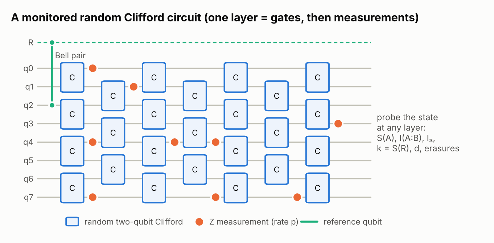
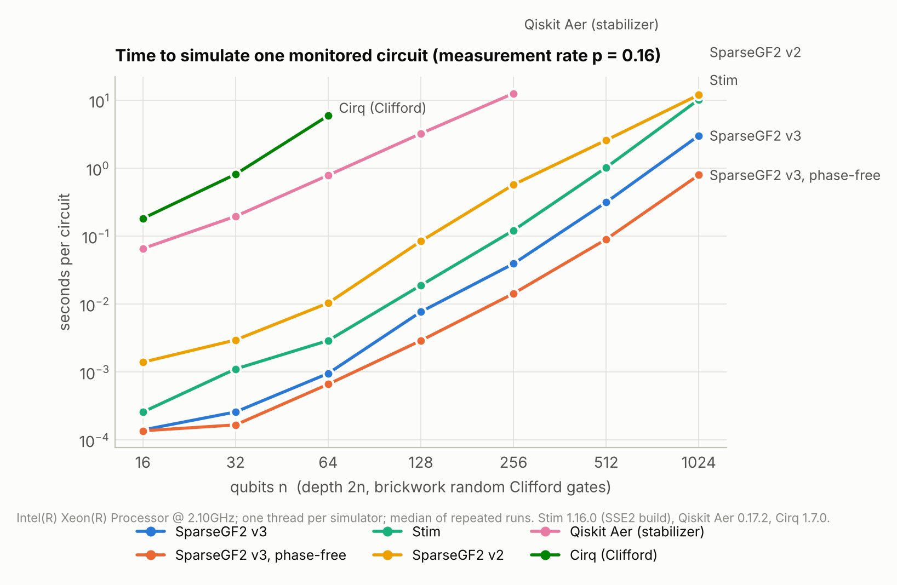
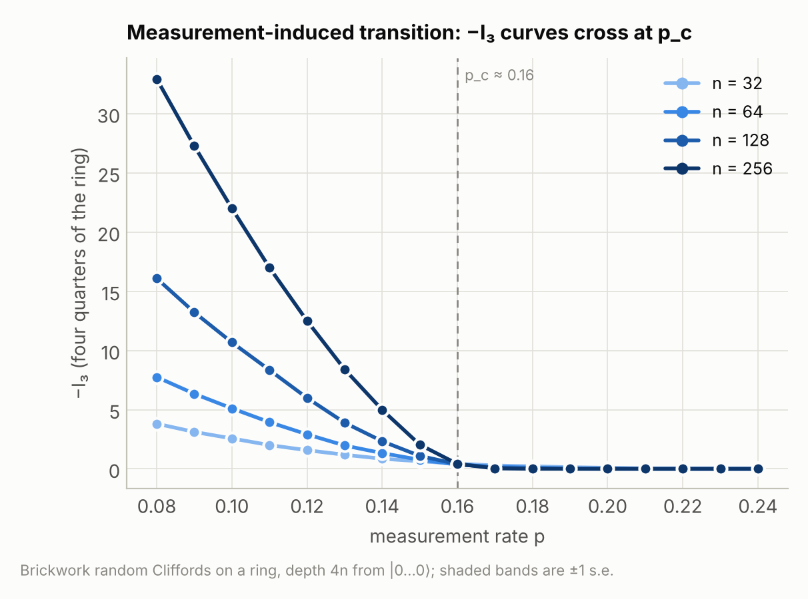

# SparseGF2

**Fast stabilizer simulation for monitored random Clifford circuits, checked against Stim.**

SparseGF2 simulates Clifford circuits with mid-circuit measurements, built for
the physics of monitored random circuits: measurement-induced and purification
transitions, the error-correcting codes these circuits generate as they run,
and their protection against erasures. It also runs general circuits written
in Stim's circuit language, surface codes included, and every operation is
tested against Stim.

> **This repository holds two versions.** **SparseGF2 v3** ([`v3/`](v3/README.md),
> import name `sparsegf2_v3`) is the new, rebuilt simulator described here; it
> will take over the `sparsegf2` name as version 3.0. **SparseGF2 v2** (the
> `sparsegf2` package at the repository root, used by
> [`studies/prl_production`](studies/prl_production/README.md)) is unchanged
> and documented in [`README_v2.md`](README_v2.md).

<picture>
  <source media="(prefers-color-scheme: dark)" srcset="v3/docs/figures/circuit-dark.png">
  
</picture>

## Speed

<picture>
  <source media="(prefers-color-scheme: dark)" srcset="v3/docs/figures/runtime-dark.png">
  
</picture>

On monitored random Clifford circuits (n qubits, depth 2n, one core each,
identical circuits, final states cross-checked):

* In phase-free mode SparseGF2 v3 is **3–15× faster than Stim** for n ≥ 64,
  and the margin grows with n. With signs tracked it is **about 3× faster**.
* It is hundreds to thousands of times faster than Qiskit Aer and Cirq.
* Its ensemble engine generates and simulates fresh random circuits in
  parallel: about **128,000 circuits per second at n = 16** and 1,700 at
  n = 128 on four cores.
* On the PRL purification-time protocol it runs **27–47× more trajectories per
  second per thread than the v2 production engine** (timed end to end), with
  statistically identical results.

Method, caveats and every number:
[v3 README, Performance](v3/README.md#performance) and
[`v3/benchmarks/`](v3/benchmarks/README.md).

## Physics in a few lines

```python
from sparsegf2_v3 import graphs, mipt

spec = mipt.MonitoredCircuit(
    num_system=128,
    edges=[graphs.watts_strogatz(128, k=4, beta=0.1, seed=(1, i)) for i in range(10_000)],
    layers=1024,                      # 8n measured layers
    measurement_rate=0.25,
    schedule="random_edges",          # n/2 random edges per layer
    reference="single",               # one reference qubit, Bell-paired ...
    reference_partner=127,            # ... with system qubit n-1
    scramble_matchings=32,            # 32 layers of random all-to-all matchings first
    checkpoints="every_layer",
    stop_when_purified=True,
)
result = spec.run(trajectories=10_000, seed=7)   # compiled, parallel over all cores
result.purification_layer                         # tau per trajectory (-1 = censored)
layers, surviving = result.survival()             # P(tau > t)
spec.circuit(trajectory=3, seed=7)                # the exact circuit trajectory 3 ran
```

The same engine records entanglement (`entropy`, `half_cut_entropy`,
`mutual_information`, `tripartite_information`, `entropy_profile`) and code
properties (`code_dimension`, `contiguous_distance`, erasure probes) at any
layers you choose. Interactive simulation, Stim-language circuits with noise
and detectors, and every observable are in the [v3 README](v3/README.md).

<picture>
  <source media="(prefers-color-scheme: dark)" srcset="v3/docs/figures/transition-dark.png">
  
</picture>

## Install

Python 3.11 or newer.

```sh
git clone https://github.com/sjbevins/SparseGF2.git
cd SparseGF2
pip install -e "./v3[test]"              # add ,mcp for the MCP server: "./v3[test,mcp]"
cd v3 && python -m pytest                # the full suite; Stim is required for the tests
```

## For AI agents

SparseGF2 v3 ships an MCP server (`sparsegf2-mcp`, registered for Claude Code
by this repository's [`.mcp.json`](.mcp.json)), a JSON CLI (`sparsegf2 ... --json`)
and a JSON service layer (`sparsegf2_v3.api`). Agents should start with
[`v3/AGENTS.md`](v3/AGENTS.md).

## Where to go next

| | |
|---|---|
| [`v3/README.md`](v3/README.md) | quickstart, figures, performance, how it works |
| [`v3/docs/DESIGN.md`](v3/docs/DESIGN.md) | architecture, decisions, roadmap |
| [`v3/docs/LITERATURE.md`](v3/docs/LITERATURE.md) | the literature behind the feature set |
| [`v3/examples/`](v3/examples/) | complete studies, including the PRL production protocol |
| [`v3/benchmarks/`](v3/benchmarks/) | reproducible speed comparisons and the v2 cross-check |
| [`README_v2.md`](README_v2.md) | the v2 package |

## License

MIT; see [`LICENSE`](LICENSE).
