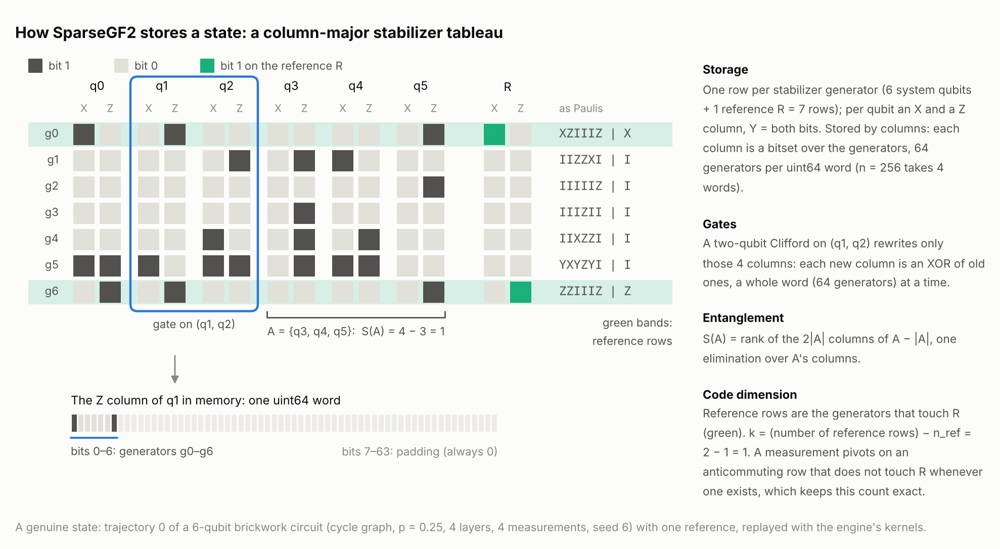
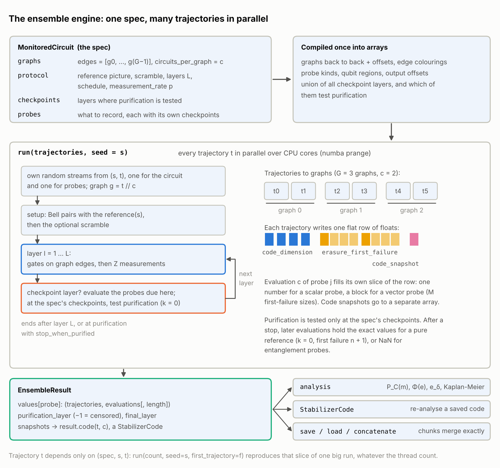
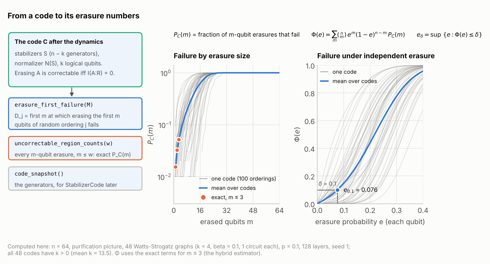

# How SparseGF2 works

This is a tour of the simulator from the inside, written for a physicist who
knows the stabilizer formalism but has not read the code. It follows one
stabilizer state from storage, through gates and measurements, to the
quantities a study records (entropies, the code dimension, erasure
statistics), and then shows how the ensemble engine runs many random
monitored circuits at once. Every statement here is checked against the
source in [`src/sparsegf2/`](../src/sparsegf2/); the reasons behind the
design choices and the benchmarks that settled them are in
[`DESIGN.md`](DESIGN.md), which this page links rather than repeats.

If you want to run simulations first and read about the machinery later,
start with [`GETTING_STARTED.md`](GETTING_STARTED.md) (and
[`MCP_GETTING_STARTED.md`](MCP_GETTING_STARTED.md) to drive the simulator from
an AI agent).

## Contents

1. [The pieces and how they fit](#1-the-pieces-and-how-they-fit)
2. [The state](#2-the-state)
3. [Gates](#3-gates)
4. [Measurement](#4-measurement)
5. [Reference qubits](#5-reference-qubits)
6. [Entropies and profiles](#6-entropies-and-profiles)
7. [Circuits](#7-circuits)
8. [The ensemble engine](#8-the-ensemble-engine)
9. [Erasure analysis](#9-erasure-analysis)
10. [The JSON layer, the CLI and the MCP server](#10-the-json-layer-the-cli-and-the-mcp-server)
11. [How correctness is checked](#11-how-correctness-is-checked)
12. [Where it is fast, and where other tools are better](#12-where-it-is-fast-and-where-other-tools-are-better)
13. [Extending it](#13-extending-it)

The Python blocks on this page are small and run as written (a few seconds
the first time, while Numba compiles the kernels).

---

## 1. The pieces and how they fit

The package (`import sparsegf2`) is layered, and each layer only calls the
ones below it ([DESIGN.md §4](DESIGN.md#4-architecture) has the module map):

| layer | modules | what it does |
|---|---|---|
| kernels | `_kernel/tableau.py`, `_kernel/entropy.py`, `_kernel/program.py`, `_kernel/ensemble.py`, `_kernel/rng.py`, `_kernel/tables.py`, `_kernel/bits.py` | Numba-compiled routines on bit-packed arrays: gates, measurements, ranks, the circuit interpreter, the ensemble loop, the random number generator and the gate tables |
| the state | `simulator.py` | `Simulator(n, phases=...)`: one stabilizer state you act on gate by gate, with method names that follow `stim.TableauSimulator` |
| circuits | `circuit.py`, `_compile.py`, `sampling.py`, `result.py` | `Circuit` (Stim's circuit language), its compilation to flat op arrays, `Simulator.run` (one shot) and `sample` (many shots in parallel) |
| observables | `observables.py` | entropies, mutual and tripartite information, code dimension, lost information, erasure statistics, contiguous distance, clipped gauge, for any `Simulator` |
| ensembles | `mipt.py`, `graphs.py` | `MonitoredCircuit`: a frozen description of a random monitored-circuit protocol, run for many trajectories inside one compiled parallel kernel; probes record what you ask for; `EnsembleResult` holds the arrays |
| codes and analysis | `codes.py`, `analysis.py` | `StabilizerCode`: a saved code analyzed after the run; estimators for P_C(m), Phi(e), e_delta, survival curves, means with errors |
| interfaces | `api.py`, `cli.py`, `mcp_server.py` | a JSON-in, JSON-out service layer, and two thin front ends on it: the `sparsegf2` command and the `sparsegf2-mcp` server |

Two execution paths share the same kernels. A **single circuit** (any
Stim-language circuit: monitored, noisy, a surface code) goes through
`Circuit`, is compiled once to an array of operations and runs in one
compiled call. An **ensemble of random monitored circuits** goes through
`MonitoredCircuit`, which never builds a `Circuit` at all: the compiled
engine draws each trajectory's gates and measurements from that
trajectory's random stream and applies them immediately. The two paths are
tied together by `spec.circuit(t, seed=...)`, which exports exactly the
circuit trajectory `t` ran, so that it can be replayed through the general
`Simulator` (section 11).

## 2. The state

<picture>
  <source media="(prefers-color-scheme: dark)" srcset="figures/tableau-dark.png">
  
</picture>

### Column-major bitsets

A stabilizer state of n qubits is fixed by n commuting, independent Pauli
generators g_0, ..., g_{n-1}. Write each generator as bits: on qubit q,
generator r has an x bit and a z bit (X = (1, 0), Z = (0, 1), Y = (1, 1)).
The textbook tableau stores this as an n × 2n binary matrix, one row per
generator.

SparseGF2 stores the **transpose**. For every qubit q it keeps two bitsets
over the generators:

* the **X column** of q: bit r is set when generator r has X or Y on q;
* the **Z column** of q: bit r is set when generator r has Z or Y on q.

Each bitset is packed 64 generators to a `uint64` word, so a column is
`Ws = ceil(n / 64)` words. The whole state is one array `tab` of shape
`(2n + 1, W)` (`_kernel/tableau.py`, module docstring):

```
tab[2q]       X column of qubit q
tab[2q + 1]   Z column of qubit q
tab[2n]       sign bits of the stabilizers (phases mode)
```

Generator ("row") r lives at bit `r & 63` of word `r >> 6`. Padding bits
beyond the last generator are always zero. This is what the GHZ state looks
like (the array is internal; it is shown here only to make the layout
concrete):

```python
import sparsegf2 as sg

sim = sg.Simulator(3, phases=False, seed=1)
sim.h(0)
sim.cx(0, 1, 1, 2)                      # GHZ state
tab, n, ws = sim._state()               # internal array, for illustration only
print(tab.shape)                        # (7, 1): 2n + 1 bitsets of one word each
for q in range(n):
    x = [(int(tab[2 * q, 0]) >> r) & 1 for r in range(n)]
    z = [(int(tab[2 * q + 1, 0]) >> r) & 1 for r in range(n)]
    print(f"qubit {q}: X column {x}, Z column {z}")
print([str(p) for p in sim.stabilizers(canonical=False)])   # ['+XXX', '+ZZ_', '+_ZZ']
```

Reading down the columns, generator 0 has X on every qubit (XXX), generator 1
has Z on qubits 0 and 1 (ZZ_), generator 2 has Z on qubits 1 and 2 (_ZZ).

Why columns: a gate on qubits (a, b) touches only the four bitsets of a and b,
and a single-qubit measurement finds every anticommuting generator by reading
one bitset. Both are word-parallel over 64 generators at a time, whatever the
entanglement of the state. The layout was chosen by benchmarking it against a
dual row-and-column layout ([DESIGN.md §5.1](DESIGN.md#51-the-data-layout-decided-by-measurement-not-taste)).
The name SparseGF2 survives from the earlier package; the storage is dense,
and what stays "sparse" is that a measurement costs time proportional to the
weight of the pivot generator.

### Two modes: `phases=True` and `phases=False`

`Simulator(n, phases=True)` (the default) is the full Aaronson-Gottesman
tableau: n stabilizers, n destabilizers and the stabilizer signs. The
destabilizers sit in a second block of words, `W = 2 Ws`: destabilizer i is
row `64 Ws + i`, at the same bit position as its stabilizer partner, one block
over. Only stabilizer signs are kept (destabilizer signs are never needed).

`Simulator(n, phases=False)` keeps only the n stabilizers and no signs
(`W = Ws`). It is about half the memory and half the work per gate, and it is
**exact** for everything that depends only on the unsigned stabilizer group:

* the bit part of a Clifford update (which Pauli each generator becomes) never
  depends on signs, only the sign part does;
* the bit part of a measurement update does not depend on the outcome: the
  outcome only sets the sign of the new generator;
* entropies, mutual information, the code dimension, lost information and
  every erasure quantity are ranks of bit matrices (sections 5, 6 and 9), so
  they never read a sign.

So phase-free evolution produces the same unsigned stabilizer group as
phase-tracking evolution along the same trajectory, and therefore the same
entanglement and code quantities. What it cannot produce is a measurement
outcome, since outcomes are signs. The ensemble engine always runs
phase-free ([DESIGN.md §5.2](DESIGN.md#52-modes) and
[§12, decision 2](DESIGN.md#12-decisions)).

### Memory

The array holds `(2n + 1) · W` words of 8 bytes: about `n²/4` bytes phase-free
and `n²/2` bytes with phases. At n = 256 that is 16 KB phase-free and 33 KB
with phases; at n = 1024, 262 KB and 525 KB. In the ensemble engine a
trajectory's tableau also holds the reference qubits, so in the purification
picture at n = 256 (512 qubits in all) it is 66 KB, and each thread holds one
such tableau plus small work buffers. A state fits in a CPU cache, which is
much of why the kernels are fast.

## 3. Gates

### Canonical indices

Every one- and two-qubit Clifford (up to a global phase) has a canonical
index (`clifford.py`, `_kernel/tables.py`):

```
index = sym · 4^k + s
```

where `sym` picks a symplectic matrix M (6 of them for k = 1, 720 for k = 2)
and bit j of `s` negates the image of the j-th generator (X_0, ..., X_{k-1},
Z_0, ..., Z_{k-1}). So the one-qubit indices run over 0..23 and the two-qubit
indices over 0..11519 (720 · 16 = 11520). `Clifford.from_index(2, i)` builds
the gate and `Clifford.index()` inverts it. Because the index enumerates the
group exactly once, **a uniformly random index is a uniformly random
two-qubit Clifford**; that is all the ensemble engine does to draw a gate
(section 8). Named gates (`H`, `CX`, `ISWAP`, ...) are just fixed indices,
and the circuit language has `CLIFFORD_2Q(i) a b` to apply one by index.

### A two-qubit gate is four column rewrites

Under a Clifford C, a generator whose restriction to qubits (a, b) is the
unsigned Pauli with bits `v = (x_a, x_b, z_a, z_b)` becomes the Pauli with
bits `v M` (mod 2), up to a sign. Because the tableau stores columns, "for
every generator at once" means: the four new columns are XORs of the four old
ones,

```
x_a' = (x_a & M00) ^ (x_b & M10) ^ (z_a & M20) ^ (z_b & M30)
x_b' = (x_a & M01) ^ (x_b & M11) ^ (z_a & M21) ^ (z_b & M31)
z_a' = ...                                    (column 2 of M)
z_b' = ...                                    (column 3 of M)
```

where each `x_a`, ... is a whole 64-generator word and each `Mij` is stored as
a mask of all ones or all zeros (`LIN2` in `_kernel/tables.py`). The kernel
`apply_2q` in `_kernel/tableau.py` loops over the words of the four columns
and does exactly this; nothing else in the tableau is read or written. The
cost is about n/64 word operations per column whether the state is a product
state or volume-law entangled.

The sign flip f(v) a generator picks up is a Boolean function of its four bits.
The tables store it in algebraic normal form (an XOR of products of bits, at
most 15 monomials for two qubits), so in phases mode the kernel evaluates it
for 64 generators at once with ANDs and XORs of the same four words and XORs
the result into the sign row. The tables are derived from the symplectic
group alone and are checked against every Clifford's conjugation table in the
tests. A gate whose symplectic matrix is the identity (a Pauli) changes only
signs, so on a phase-free state it is an exact no-op. One-qubit gates
(`apply_1q`) work the same way with two columns.

## 4. Measurement

Measuring a Pauli P (here a single-qubit Z on qubit q; X, Y and Pauli products
work the same way, `measure_1q` and `measure_pauli`):

1. **Find the anticommuting generators.** A generator anticommutes with Z_q
   exactly when it has X or Y on q, which is the X column of q. One read of
   that bitset gives the mask `anti` of all anticommuting generators (for X_q
   it is the Z column; for Y_q the XOR of both; for a product, the XOR over its
   factors).
2. **No anticommuting stabilizer: the outcome is deterministic.** The state
   does not change. With phases, the outcome is the sign of ±P as a product of
   stabilizers: the destabilizers that anticommute with P select which
   stabilizers multiply to it, and `product_exponent` computes the resulting
   power of i with popcounts. Without phases there is nothing to compute.
3. **Otherwise the outcome is random.** The **pivot** p is the anticommuting
   stabilizer with the lowest index (the first set bit of `anti`). The kernel
   lists the qubits in the pivot's support (one bit read per qubit), then
   multiplies the pivot into every other anticommuting generator at once: for
   each qubit c in the support, it XORs the mask `anti` into c's X column if
   the pivot has an x bit on c, and into c's Z column if it has a z bit. That
   flips exactly the right bits of exactly the right generators, a whole word
   at a time. With phases, the factors of i from these products are tracked by
   a two-bit counter per generator (word-parallel), the pivot's old value
   becomes its own destabilizer, and the new row p gets the outcome's sign.
   Finally row p is replaced by P.

The cost of a random measurement is one bitset read, n bit reads to find the
support, and (pivot weight) × W word operations for the multiplication
([DESIGN.md §5.3](DESIGN.md#53-operations-and-their-cost) has the full cost
table). Choosing the lowest-index pivot rather than the lightest one was also
settled by benchmark; the choice changes which generators you get, never the
state.

**Randomness and outcomes.** The outcome of a random measurement is a "coin",
one bit from the simulator's random stream. Every measurement consumes
exactly one coin whether or not its outcome turns out to be random, so the
stream advances identically however the outcomes fall, and you can force
outcomes (`sim.measure(q, coin=b)`, `sim.run(circuit, coins=...)`) without
shifting the randomness of anything later
([DESIGN.md §6.2](DESIGN.md#62-randomness-and-the-measurement-record)).

**Phase-free mode** performs the same projection on the stabilizer rows only
(`measure_1q_phase_free`, fused into one loop with no signs and no
destabilizers). It knows whether the outcome was random, but not its value,
so `measure()` returns `None`, `RunResult.measurements` raises
`PhaseFreeError`, and `RunResult.random` and `Simulator.is_deterministic`
work in both modes:

```python
import sparsegf2 as sg

pf = sg.Simulator(3, phases=False, seed=1)
pf.h(0)
pf.cx(0, 1, 1, 2)                       # GHZ state
print(pf.is_deterministic("Z0"))        # False
print(pf.measure(2))                    # None: no outcome without signs
print(pf.is_deterministic("Z0"))        # True: the state has collapsed

result = sg.Simulator(2, phases=False, seed=1).run(sg.Circuit("H 0\nCX 0 1\nM 0 1"))
print(result.random)                    # [ True False]: the second outcome was fixed by the first
```

## 5. Reference qubits

### The pictures

Code properties of a monitored circuit are measured by entangling the system
with reference qubits that no gate or measurement ever touches. System qubits
are `0..n-1` and references follow. `MonitoredCircuit(reference=...)` sets
them up (`mipt.py`, `_setup` in `_kernel/ensemble.py`):

* `"purification"`: system qubit i is Bell-paired with reference `n + i`
  (an H on i, then CX(i, n + i)). The system starts maximally mixed and holds
  n logical qubits.
* `"single"`: one reference, qubit n, is Bell-paired with `reference_partner`
  (a fixed system qubit, or one drawn per trajectory).
* `"none"`: the system starts in |0...0>, and probes that need a reference
  are refused when the spec is built.

With system and reference in a pure joint state, the number of logical qubits
the system still protects is the code dimension `k = S(R)`, and erasing a set
A of system qubits destroys `I(A:R)` bits of logical information. The
reference has purified when k = 0.

### The pivot rule that keeps the reference rows a basis

Call a stabilizer row **marked** if it has support on R; the engine keeps
these rows as a bitset `ref_rows`. Right after the Bell pairing, the marked
rows have linearly independent R-parts (in the purification picture they are
X_i X_{n+i} and Z_i Z_{n+i}). The engine maintains that invariant for the
whole trajectory with one refinement of the pivot rule
(`measure_1q_phase_free_tracked` in `_kernel/tableau.py`):

* Gates act only on system columns, so they never change any row's R-part.
* When a measurement is random, the pivot is the first anticommuting row
  **without** support on R, if there is one. Multiplying it into other rows
  leaves every R-part unchanged, and it is replaced by the measured Pauli,
  which has no R support either. Nothing about the marked rows changes.
* If every anticommuting row is marked, the pivot is the first of them.
  Multiplying it into the other anticommuting marked rows replaces their
  R-parts r_i by r_i + r_p, which stay independent and nonzero; the pivot row
  becomes the measured Pauli and leaves the marked set. One logical qubit has
  been measured out.

Either way the stabilizer group is the same as with the plain lowest-index
rule; only the choice of generators differs.

### k and I(A:R) without touching the reference columns

With that invariant, the stabilizers restricted to R have rank equal to the
number of marked rows, so

```
k = S(R) = popcount(ref_rows) - |R|
```

which the engine reads once per checkpoint (`s_ref` in `run_ensemble`). For a
set A of system qubits, the unmarked rows have no R-part, so the rank of the
stabilizers restricted to R ∪ A is `popcount(ref_rows) + rank_free(A)`, where
`rank_free(A)` is the rank of A's columns over the unmarked rows only.
Putting that into `I(A:R) = S(A) + S(R) - S(AR)`, with `S(X) = rank(X) - |X|`
(section 6), every reference term cancels:

```
I(A:R) = rank(A) - rank_free(A)
```

(`lost_information_rows` in `_kernel/entropy.py`). Both ranks are over the
2|A| columns of A; the reference columns never enter an elimination. These
are identities, not approximations, and
[`tests/test_reference_rows.py`](../tests/test_reference_rows.py) checks them
at every step of random evolutions against the generic formulas. The unmarked
rows, restricted to the system, generate the code's stabilizer group S, and
all rows restricted to the system span its normalizer N(S); section 9 builds
on that. On a `Simulator` you build yourself, the same quantities come from
`observables.code_dimension` and `observables.lost_logical_information`,
which use the generic entropy formulas.

## 6. Entropies and profiles

For a pure stabilizer state, the entanglement entropy (in bits) of a set A of
qubits is

```
S(A) = rank(stabilizers restricted to A) - |A|
```

(Fattal et al., quant-ph/0406168). In the column layout, the restriction to A
is simply the 2|A| bitsets of A's X and Z columns, so the rank is a Gaussian
elimination over those bitsets with no transposition (`columns_rank` in
`_kernel/tableau.py`): about |A|² · n/64 word operations. Since
`S(A) = S(complement of A)` for a pure state, every routine works on the
smaller side (`Simulator.entropy`, `region_entropy`), and one qubit has its
own shortcut (its entropy is 1 exactly when its two columns are nonzero and
different).

An **entanglement profile**, S of every prefix of an ordering, is one
incremental pass (`prefix_entropies` in `_kernel/entropy.py`): the routine
keeps a reduced basis of bitsets keyed by their lowest set bit, adds one
qubit's two columns at a time (cost proportional to the current rank), and
records `rank - m` after m qubits. The same incremental basis drives the
erasure profiles, the contiguous distance and the first-failure scans of
section 9.

```python
import numpy as np
import sparsegf2 as sg
from sparsegf2 import observables

sim = sg.Simulator(8, phases=False, seed=2)
sim.run(sg.Circuit("\n".join(f"CLIFFORD_2Q({1000 * i + 7}) {i} {(i + 1) % 8}" for i in range(8))))
profile = observables.entropy_profile(sim)                       # one pass
assert np.array_equal(profile, [sim.entropy(range(m)) for m in range(9)])
print(profile)                                                   # [0 0 0 1 1 1 1 1 0]
```

## 7. Circuits

### Parsing

A `Circuit` (`circuit.py`) is a list of immutable `Instruction`s and
`RepeatBlock`s whose text form is Stim's text form: every Clifford gate, the
measurements and resets (`M MX MY MR MRX MRY MXX MYY MZZ MPP R RX RY`), Pauli
noise channels, `TICK`, `DETECTOR`, `OBSERVABLE_INCLUDE`, coordinates,
`REPEAT`, and classically controlled Paulis (`CX rec[-1] 5`), plus the two
extensions `CLIFFORD_1Q(i)` and `CLIFFORD_2Q(i)`. Anything unsupported raises
an error naming the instruction. `Circuit.from_stim` and `to_stim` convert
both ways (indexed Cliffords are expanded into Stim gates on export).
[DESIGN.md §6.1](DESIGN.md#61-the-language) has the list by milestone.

### Compilation and the compiled loop

`Simulator.run(circuit)` first compiles the circuit (`_compile.py`):
`REPEAT` blocks are unrolled (up to `max_ops`, 50 million operations by
default, a guard against accidental huge repeat counts), gate names become
canonical Clifford indices, Pauli products go to side arrays, and detectors
and observables become lists of absolute measurement indices. The result is
an `(num_ops, 5)` int64 array, one row per operation:

```
OP_1Q        qubit, 1-qubit Clifford index
OP_2Q        qubit a, qubit b, 2-qubit Clifford index
OP_MEASURE   qubit, basis, flags (invert, reset after), flip-probability slot
OP_MPP       start and length in the product arrays, flags, slot
OP_RESET     qubit, basis
OP_NOISE1/2  qubit(s), channel, parameter slot
OP_FEEDBACK  record index, qubit, Pauli
OP_TICK
```

The compiled program is cached on the circuit until the circuit (or a
`REPEAT` body in it) changes. One compiled function, `run_program` in
`_kernel/program.py`, then walks the array and calls the gate and measurement
kernels; Python is never involved per gate. The random draws are fixed by the
program: each measurement takes one coin (and one uniform number if it has a
flip probability), each reset one bit, each noise target one uniform number,
in program order. Noise is drawn in phase-free mode too (a Pauli is a no-op
there), so the stream stays aligned between the two modes.

### Many shots

`sample(circuit, shots, seed=...)` (`sampling.py`) runs the same program from
|0...0> once per shot, in parallel over CPU cores (`run_many`, a Numba
`prange` loop). Shot s uses its own random stream, derived from `(seed, s)`
by a splitmix64 hash into a xoshiro256** state (`_kernel/rng.py`), so the
result is identical whatever the thread count. Detection events and
observable flips are reported relative to a noiseless reference record, as
in Stim ([DESIGN.md §9](DESIGN.md#9-qec-and-other-clifford-circuits-m7)
describes the one documented difference in that reference record).

### Observing at TICKs

`Simulator.run(circuit, observe=f)` calls `f(sim, tick)` after every `TICK`.
The compiled loop returns at each `TICK`, Python calls your function on the
paused state, and the loop resumes where it stopped; the return values are
collected in `RunResult.observations`. This is how to record any observable as
a function of depth for a single circuit. For ensembles, where calling Python
after every layer would cost more than the layer, observation happens inside
the compiled engine instead (probes, next section).

## 8. The ensemble engine

<picture>
  <source media="(prefers-color-scheme: dark)" srcset="figures/engine-dark.png">
  
</picture>

### The protocol

`mipt.MonitoredCircuit` is a frozen, validated description of a protocol. Its
module docstring is the reference; in short, each trajectory does:

1. **Setup**: the reference picture (section 5).
2. **Scramble** (optional, in this order): `scramble_gates` random two-qubit
   Cliffords on uniformly random distinct pairs; `scramble_matchings` layers of
   gates on uniformly random perfect matchings of the system; `scramble_layers`
   gate-only layers of the dynamics schedule.
3. **Layers**, `layers` times: two-qubit gates on edges of the interaction
   graph, placed by `schedule`, then each system qubit measured in Z with
   probability `measurement_rate`:
   * `"matching"`: cycle through an edge coloring of the graph (on an even
     ring, the usual brickwork of even and odd bonds); the color cycle runs on
     from the scramble layers into the dynamics;
   * `"random_edges"`: `gates_per_layer` edges (default n // 2) drawn with
     replacement, uniformly or with probabilities `edge_weights`;
   * `"all_edges"`: every edge, in order.

   Each gate is a uniform draw from `gate_set`, by default all 11520 indices,
   i.e. a uniformly random two-qubit Clifford. A "layer" always means exactly
   this; it is never rescaled.
4. **Checkpoints**: after the layers in `checkpoints` (layer 0 is the state
   after setup and scramble), the probes due at that layer are evaluated and,
   with a reference, purification is tested.

The graph is fixed for the whole trajectory (quenched disorder).
`spec.circuit(t, seed=...)` returns this protocol as a `Circuit`: setup gates,
the scramble as `CLIFFORD_2Q`, a `TICK` (checkpoint layer 0), then per layer
the `CLIFFORD_2Q` gates, an `M` and a `TICK`, so tick t of a replay sees the
state after layer t.

### Graph collections

`edges` can be one graph or a list of G graphs, with `circuits_per_graph = c`
circuits on each (default 1). The compiled arrays hold the graphs back to
back with offsets, and trajectory t runs on graph `t // c`, so graph g carries
the contiguous block of trajectories `g·c .. g·c + c - 1`
(`EnsembleResult.graph_index`). With a collection,
`spec.num_trajectories = G·c` and `spec.run(seed=...)` runs them all. Graphs
are built with their own seeds (for example
`graphs.watts_strogatz(n, 4, beta, seed=(17, g))`) and never draw from the
circuit's random streams, so the same collection serves every measurement
rate. Why the mapping is blocked rather than cyclic is in
[DESIGN.md §8.1](DESIGN.md#81-graph-collections).

### The randomness contract

`run(seed=s)` turns s into a `numpy.random.SeedSequence` and draws two 128-bit
keys from it: one for **circuit structure**, one for **probe sampling**.
Trajectory t draws its circuit from stream t of the first key: a xoshiro256**
state computed from `(key, t)` alone (`stream_state` in `_kernel/rng.py`, which
mixes all 128 key bits). Each evaluation of a sampled probe draws from its
own stream under the second key, indexed by the trajectory, the probe's name
and the layer (the `correlated_erasure` probe's also by the region size: each
size draws from a stream of its own), so its samples never depend on the other
probes, the other sizes or the checkpoints (randomness contract 2,
`mipt.RANDOMNESS_CONTRACT`). Within a
trajectory the draws come in a fixed order (module docstring of
`_kernel/ensemble.py`): the random reference partner if any, the scramble,
then per layer the gates (an
edge if edges are sampled, an orientation bit if enabled, a gate index) and
then **one uniform number per system qubit** for the measurement mask, whether
or not that qubit ends up measured. Three consequences:

* **Trajectory t depends only on (spec, s, t).** Not on the thread count, not
  on the other trajectories, not on how a run is split into chunks:
  `run(count, seed=s, first_trajectory=f)` is exactly the slice
  `f .. f + count - 1` of one big run, and `EnsembleResult.concatenate`
  merges chunks back.
* **Measurement rates share randomness.** At a fixed seed, the gates and the
  uniform numbers are the same at every rate, and qubit q is measured in a
  layer when its uniform number is below p. So the qubits measured at a lower
  rate are a subset of those measured at a higher rate (common random numbers
  across a rate scan).
* **The circuit never depends on the probes.** Probes draw only from the probe
  streams, so adding or removing a probe never changes the trajectory, and a
  replay with other probes or checkpoints reproduces the sampled probes too.

```python
from dataclasses import replace

import numpy as np
from sparsegf2 import graphs, mipt

spec = mipt.MonitoredCircuit(
    num_system=8, edges=graphs.cycle(8), layers=12, measurement_rate=0.2,
    reference="purification", checkpoints="every_layer",
    probes=[mipt.code_dimension(), mipt.half_cut_entropy()],
)
res = spec.run(4, seed=3)
k = res.values["code_dimension"]                  # (4 trajectories, 13 checkpoints)

part = spec.run(2, seed=3, first_trajectory=2)    # a chunk is the same slice
assert np.array_equal(k[2:], part.values["code_dimension"])
assert np.array_equal(k, spec.run(4, seed=3, num_threads=1).values["code_dimension"])


def measured(spec, t, seed):
    """The set of measured qubits in each layer of trajectory t (from the exported circuit)."""
    layers, current = [], set()
    for ins in spec.circuit(t, seed=seed):
        if ins.name == "M":
            current |= {target.value for target in ins.targets}
        elif ins.name == "TICK":
            layers.append(current)
            current = set()
    return layers


low = measured(spec, 0, 3)
high = measured(replace(spec, measurement_rate=0.5), 0, 3)
assert all(a <= b for a, b in zip(low, high))    # nested measured sets across rates
```

### Probes

A probe is a frozen `Probe(kind, name, regions, size, samples, checkpoints)`
made by a factory (`mipt.code_dimension()`, `mipt.erasure_first_failure(100)`,
...). How the engine treats each kind is one entry in the registry `_KINDS` in
`mipt.py`:

```
"code_dimension":        _Kind(PROBE_CODE_DIMENSION, True, "one",     "zero")
"erasure_first_failure": _Kind(PROBE_FIRST_FAILURE,  True, "samples", "n+1", True)
"entropy_profile":       _Kind(PROBE_ENTROPY_PROFILE, False, "profile", "nan")
```

The fields are the kernel code that `eval_probe` in `_kernel/ensemble.py`
branches on, whether a reference is needed, how many numbers one evaluation
writes (`"one"`, `"profile"` = n + 1, `"samples"`, `"size"`), the value
recorded after a stop at purification, and whether the probe draws random
orderings. Everything else is derived from this table when the spec compiles
itself into arrays (`MonitoredCircuit._arrays`):

* **Flat output rows.** Each trajectory writes one row of float64. Probe j
  owns a slice of it: evaluation c fills
  `out[t, poff[j] + c·plen[j] : ... + plen[j]]`. `EnsembleResult.values[name]`
  is that slice reshaped to `(trajectories, evaluations)` for a scalar probe
  or `(trajectories, evaluations, length)` for a vector one.
* **Per-probe schedules.** Every probe takes `checkpoints=` in the same forms
  as the spec (`"final"`, `"every_layer"`, a stride, a list of layers);
  without it, it follows the spec's. The engine stops at the union of all
  schedules, reads k once there (a popcount), and evaluates exactly the
  probes whose next scheduled layer it is. `result.layers(name)` gives a
  probe's layers. A cheap probe can run every layer while an expensive one
  runs at a few depths.
* **Purification** is tested only at the spec's own checkpoints, so the
  purification layer does not depend on which probes are attached or when
  they run. `purification_layer` is -1 for a trajectory that never purified
  (right-censored).
* **Stopping.** With `stop_when_purified`, a trajectory ends at its
  purification layer, and its remaining evaluations are filled with each
  probe's exact value for a pure reference: 0 for `code_dimension`,
  `lost_information`, `erasure_lost_profile` and
  `uncorrectable_region_counts`, n + 1 for `erasure_first_failure`, n for
  `code_snapshot` (no code stored). Entanglement probes and
  `contiguous_distance` are NaN there, since the system keeps evolving and
  the stopped trajectory no longer follows it. Code-rate and erasure averages
  over all trajectories therefore need no special handling.
* **Code snapshots.** `code_snapshot` writes the code's generators (the
  unmarked rows, packed as X words then Z words over the system) into a
  separate buffer of shape `(trajectories, evaluations, n, 2·ceil(n/64))`, and
  their number, n - k, into the flat row. `result.code(t, c)` decodes one as a
  `StabilizerCode`. At most one snapshot probe per spec.

[DESIGN.md §8.2](DESIGN.md#82-probes-schedules-and-the-output-layout) has the
array names in full.

### Parallelism and results

`run_ensemble` in `_kernel/ensemble.py` is a single Numba function whose
outer loop over trajectories is a `prange`, so trajectories run in parallel
over all cores, each with its own tableau, buffers and random streams.
`run(num_threads=...)` limits the threads for one call; the environment
variable `NUMBA_NUM_THREADS` sets the ceiling. Inside a trajectory, everything
(drawing a layer, applying it, measuring, evaluating probes) happens in
compiled code. On one thread of this 4-core machine, a dynamics layer at
n = 256 (n/2 random two-qubit Cliffords on a Watts-Strogatz graph, then the
measurements) took 25 to 60 µs depending on the picture and the rate
(measured over 2000 layers, 4 trajectories each, at p = 0.05 and 0.2, with
and without the purification reference). The kernels are compiled on first
use and cached on disk, so later runs start immediately.

`EnsembleResult` holds `values`, `snapshots`, `purification_layer`,
`final_layer`, `num_measurements`, the trajectory indices, the exact seed used
(`seed_sequence` repeats the run) and the package version. `survival()` gives
P(tau > layer) at the checkpoints, `mean(name)` averages ignoring NaN,
`save(path)` writes a compressed `.npz` with the spec and seed, `load` reads
it back, and `concatenate` refuses to merge chunks of different protocols,
seeds or versions, or chunks that share trajectories.

## 9. Erasure analysis

<picture>
  <source media="(prefers-color-scheme: dark)" srcset="figures/erasure-analysis-dark.png">
  
</picture>

The erasure studied is independent erasure of every system qubit with
probability e **after** the dynamics, so everything below acts on the code at
a checkpoint and never changes the trajectory
([DESIGN.md §12, decision 9](DESIGN.md#12-decisions)).

### The quantities

With S the code's stabilizer group on the system, N(S) its normalizer, and
`G|_A` the restriction of a group's generators to a set A of qubits, erasing
A loses

```
l(A) = I(A:R) = rank(N(S)|_A) - rank(S|_A)
```

bits of logical information. The erasure is **correctable** exactly when
`l(A) = 0`, and l never decreases when qubits are added. From l:

* **P_C(m)**: the fraction of m-qubit erasures that are uncorrectable;
* **Phi_C(e)**: the probability that independent erasure with probability e
  is uncorrectable, `Phi_C(e) = sum_m C(n, m) e^m (1 - e)^(n - m) P_C(m)`;
* **e_delta**: the largest erasure probability whose ensemble-averaged
  failure probability is at most delta, `e_delta = sup{e : Phi(e) <= delta}`.

### Adapted columns

Both ranks in l(A) are ranks of A's columns, over different sets of rows. The
kernel `code_columns` (`_kernel/entropy.py`) row-reduces the generators
restricted to the system, unmarked rows first: the first s = n - k echelon
rows span S and all r = n + k span N(S). It then transposes the echelon, so
qubit q gets an X column and a Z column of r bits. Row operations leave the
rank of any set of columns unchanged, so for every A, `rank(N(S)|_A)` is the
rank of A's 2|A| columns and `rank(S|_A)` the rank of the same columns cut to
their first s bits. One compact array serves both ranks for every set, and
the two routines below work only on it.

### First-failure sizes: every m at once

`erasure_first_failure(samples=M)` draws M uniformly random orderings of the
system qubits (Fisher-Yates from the evaluation's probe stream) and, for each, records the
**first-failure size** D: the smallest m such that erasing the first m qubits
of the ordering is uncorrectable (n + 1 when k = 0, with no random draws).
The scan (`first_failure_samples`) adds qubits one at a time to an
incremental basis of their S-columns. While the S-rank is 2m the prefix is
correctable (since `rank_N <= 2m` too), and the N(S) rank is never computed.
At the first prefix whose S-rank falls short, the N(S) basis is built once;
from then on both grow together until `rank_N > rank_S`, which is D, and the
scan stops.

Because the prefixes of a uniformly random ordering are uniformly random
m-subsets for every m, and failure is monotone, `D <= m` exactly when the
first m qubits form an uncorrectable erasure. So the fraction of samples with
`D <= m` estimates P_C(m) for every m from the same M scans
(`analysis.failure_by_size`), and the mixture over m collapses to

```
Phi_C(e) = mean_j Pr[Bin(n, e) >= D_j]
```

(`analysis.erasure_failure_probability`).

### Exhaustive counts for small erasures

`uncorrectable_region_counts(max_size=w)` counts, for m = 1..w, the m-subsets
with `l > 0`, so `count / C(n, m)` is the exact P_C(m), and all counts are 0
exactly when the distance exceeds w. Done naively that is C(n, w) rank
computations; `uncorrectable_counts_rows` does far less:

* **Depth-first over prefixes with pruning.** Sets are walked as increasing
  index sequences, depth-first up to w - 1 qubits, each level keeping a small
  echelon basis of the prefix's S-columns. When a prefix with largest index i
  fails, every extension fails too (monotonicity), so the kernel adds
  C(n - 1 - i, j) to the count of size |P| + j for every j and skips the
  subtree.
* **Lazy N(S) rank.** A prefix whose S-columns have full rank 2|P| is
  correctable without looking at N(S), so the N(S) basis is extended only when
  an S-rank falls short or the last step below needs it, rebuilt from the
  deepest level that has one.
* **The last qubit by hash lookup.** For a correctable prefix P of w - 1
  qubits, the last qubit c is not looped over. Adding c's columns x_c, z_c
  raises a rank by `2 - dim K`, where K is the set of pairs (a, b) with
  `a x_c + b z_c` in the span of P's columns. With P correctable,
  `l(P + c) = dim K_S - dim K_N` (K_S computed with the columns cut to s bits,
  K_N with full columns). A relation among full columns survives the cut, so
  `K_N ⊆ K_S`, and c makes the set uncorrectable exactly when
  `K_S != K_N`. A nonzero element of K means one of x_c, z_c or
  y_c = x_c + z_c lies in the span. So the kernel enumerates the at most
  4^(w-1) elements of P's S-span (in Gray-code order, one XOR per step) and
  looks each up in a hash table of every qubit's X, Z and Y columns. That
  finds K_S for all candidates c at once. Most qubits have K_S = {0} and
  cannot fail; for the few others, the same lookup over P's N(S)-span gives
  K_N, and c is counted where they differ.

The walk visits about C(n, w - 1) prefixes with up to 4^(w-1) lookups each,
instead of C(n, w) rank computations
([DESIGN.md §8.4](DESIGN.md#84-erasure-kernels) has the same argument with
the kernel's variable names).

### The hybrid estimator and e_delta

Sampling resolves small erasures worst, and small erasures are exactly what
the exhaustive counts give exactly. With `exact_counts`,
`erasure_failure_probability` uses the exact P_C(m) for m <= w and lets the
samples cover only the rest:

```
Phi_C(e) = sum_{m <= w} b_m(e) P_exact(m) + mean_j Pr[Bin(n, e) >= max(D_j, w + 1)]
```

with b_m the binomial weights. `analysis.erasure_tolerance(first, n, delta,
exact_counts=...)` averages Phi over the codes you pass and returns e_delta.
The true Phi is non-decreasing in e, but a hybrid estimate from few samples
need not be, so the function locates the last crossing of delta on a grid of
2048 steps in e and refines it by bisection to about 1e-12. A code with
k = 0 has D = n + 1 everywhere and Phi = 0; to condition on k > 0, select
those trajectories before the call.

### Codes after the run: `StabilizerCode`

`StabilizerCode` (`codes.py`) is a code given by its generators, for example
one returned by `result.code(t, c)`. It computes a basis of N(S) (the
symplectic complement of the generators), stacks the S generators and that
basis into one column-major tableau, and marks the N(S) rows as if they were
reference rows. The unmarked rows then span S and all rows span N(S), which
is exactly the engine's situation, so the same kernels compute `l(A)`
(`lost_information`), first-failure sizes (`first_failure_sizes`) and
exhaustive counts (`uncorrectable_counts`). Redundant generators are
harmless: `code_columns` discards them. A saved code can therefore be
re-analyzed later with more orderings or a larger exhaustive search than the
run used. The five-qubit code makes a good check, since its distance is 3 and
every 3-qubit erasure destroys the logical qubit:

```python
import math

import sparsegf2 as sg
from sparsegf2 import analysis

code = sg.StabilizerCode(["XZZX_", "_XZZX", "X_XZZ", "ZX_XZ"])
print(code.num_logical, code.uncorrectable_counts(3))   # 1 [ 0  0 10]: d = 3
first = code.first_failure_sizes(100, seed=0)            # every ordering fails at m = 3
phi = analysis.erasure_failure_probability(first, 5, 0.1)
exact = sum(math.comb(5, m) * 0.1**m * 0.9 ** (5 - m) for m in range(3, 6))
assert abs(phi - exact) < 1e-12                          # Pr[Bin(5, 0.1) >= 3]
```

### Measured costs

Single-thread cost per evaluation at n = 256, for codes generated by random
circuits ([DESIGN.md §8.4](DESIGN.md#84-erasure-kernels)); in the engine the
trajectories run in parallel over all cores:

| probe | cost per evaluation |
|---|---|
| `erasure_first_failure`, M = 100 samples | about 2 ms |
| `uncorrectable_region_counts`, w = 2 | about 1 ms |
| `uncorrectable_region_counts`, w = 3 | about 20 ms |
| `uncorrectable_region_counts`, w = 4 | about 4 s (C(256, 4) = 1.7·10^8 sets; practical only at a few depths) |

(n = 256, one thread, AMD Ryzen 9 9950X3D, 2026-10-15; every n and w in
[`benchmarks/results/erasure_cost.md`](../benchmarks/results/erasure_cost.md).)
| `code_snapshot` | under 1 ms, but about 16 KB per stored code |

Values are stored as float64, so `erasure_first_failure` costs 8·M bytes per
evaluation per trajectory. That is why the expensive and large probes
usually get their own sparse `checkpoints`
([GETTING_STARTED.md §5.2](GETTING_STARTED.md#52-estimate-time-and-memory-before-running)
works through the budget for a full study).

## 10. The JSON layer, the CLI and the MCP server

`api.py` is a service layer that takes and returns plain JSON values:
`capabilities`, `inspect_circuit`, `run_circuit`, `run_ensemble`,
`estimate_ensemble`, `start_ensemble_job`, `job_status`, `cancel_job`,
`list_jobs` and `load_results`. A JSON ensemble spec mirrors the
`MonitoredCircuit` fields (with the graph given as
`{"family": ..., params}`, and `"realizations": G` for a collection), and is
turned into exactly `MonitoredCircuit(...).run(trajectories, seed=seed)`.
The layer validates every argument with messages that say what to change,
summarizes results into compact JSON (means and standard errors at up to 50
checkpoints, the erasure probes as P_C(m) curves), writes full arrays only
when given an `output_dir` (`result.npz`, `spec.json`, `provenance.json`),
and refuses runs whose result would exceed 8 GB. Probe kinds and graph
families are discovered from `mipt.__all__` and `graphs.__all__`, so a new
probe or graph family appears in every interface without editing them.

Background jobs run an ensemble in chunks (about 10 s each by default), save
each chunk as soon as it finishes, and can be resumed or extended by starting
the same job again with the same `output_dir`; chunks merge exactly because of
the randomness contract of section 8.

`cli.py` (`sparsegf2 capabilities | inspect | run | ensemble | results`, with
`--json`) and `mcp_server.py` (`sparsegf2-mcp`, tools of the same names plus
two prompts and the resources `docs://sparsegf2/quickstart` and
`docs://sparsegf2/capabilities`) are thin wrappers, so all three front ends
share one implementation and one set of error messages. The MCP tool
`run_ensemble` refuses a run estimated above 60 s and points to
`start_ensemble_job`. [`MCP_GETTING_STARTED.md`](MCP_GETTING_STARTED.md)
covers setup and a first session, [`LLM_INTERFACE.md`](LLM_INTERFACE.md) is
the reference, and [DESIGN.md §13](DESIGN.md#13-interfaces-for-ai-agents)
gives the reasoning.

## 11. How correctness is checked

Stim is the oracle, and the test suite refuses to run without it
([DESIGN.md §10](DESIGN.md#10-testing-strategy)). The main checks:

* **Lock-step against Stim** ([`tests/_lockstep.py`](../tests/_lockstep.py),
  [`tests/test_simulator.py`](../tests/test_simulator.py)). Random operations
  are applied to `stim.TableauSimulator`, to a phase-tracking `Simulator` and to
  a phase-free one at the same time; random outcomes are forced onto Stim with
  its `postselect_*` methods. After every operation, deterministic outcomes and
  the random/deterministic flag must match, and the canonical stabilizer list
  must equal Stim's (with signs in phases mode, without in phase-free mode),
  from |0...0> and from random initial states, at sizes that cross the 64-bit
  word boundaries.
* **Whole-circuit replay** ([`tests/test_run.py`](../tests/test_run.py)).
  Stim's measurement record is fed to `Simulator.run` as `coins`, and every
  outcome and the final state must come back identical. Noisy circuits are
  compared statistically with Stim's sampler, including a noisy surface code.
* **Gate tables**: every one- and two-qubit Clifford's column update and sign
  function are compared with its conjugation table, and the gate library with
  `stim.gate_data()`.
* **Observables** against state-vector calculations (entropies by SVD) on
  small systems and against brute force.
* **The engine against its exported circuits**
  ([`tests/test_mipt.py`](../tests/test_mipt.py)). Each trajectory's
  `spec.circuit(t, seed)` is replayed through the general `Simulator` with an
  `observe` callback, and every probe value must equal the engine's at every
  checkpoint, exactly (a small version of this check follows the list).
  The same file checks thread and chunk independence, the nested measured sets
  across rates, and the exact values after a stop.
* **Reference rows** against the generic formulas at every step of random
  evolutions ([`tests/test_reference_rows.py`](../tests/test_reference_rows.py)).
* **Erasure kernels** against brute force
  ([`tests/test_codes.py`](../tests/test_codes.py)): `l(A)` and the exhaustive
  counts against the check-matrix formula
  `l(A) = 2|A| - s - rank(H_A) + rank(H_Abar)` over every subset of small
  codes (also codes wider than one 64-bit word), the first-failure law against
  the exact P_C(m), the estimators against their definitions, and the engine's
  sampled probes against the codes the same run saved.
* **The documentation**: the Python blocks of the README and the getting-started
  guide run in the test suite ([`tests/test_docs.py`](../tests/test_docs.py)).

The engine-against-replay check in miniature: run trajectory 1 in the engine,
then replay its exported circuit through a plain `Simulator` and read the code
dimension at every `TICK`.

```python
import numpy as np
import sparsegf2 as sg
from sparsegf2 import graphs, mipt

spec = mipt.MonitoredCircuit(
    num_system=8, edges=graphs.cycle(8), layers=12, measurement_rate=0.2,
    reference="purification", checkpoints="every_layer", probes=[mipt.code_dimension()],
)
engine = spec.run(2, seed=3).values["code_dimension"][1]          # trajectory 1, every layer
sim = sg.Simulator(spec.num_qubits, phases=False, seed=0)
replay = sim.run(spec.circuit(1, seed=3), observe=lambda s, tick: s.entropy(spec.reference_qubits))
assert np.array_equal(engine, [k for _, k in replay.observations])
```

## 12. Where it is fast, and where other tools are better

SparseGF2 is built for monitored circuits: many measurements, many
trajectories, and the state inspected along the way. On the benchmark workload
(random two-qubit Cliffords in a brickwork on a ring, depth 2n, Z
measurements at rate p, one core) the phase-free mode is several times faster
than Stim and the margin grows with n, the phase-tracking mode is about 3×
faster, and the ensemble engine adds parallelism over trajectories on top;
the figures, tables and fairness rules are in
[README.md, Performance](../README.md#performance) and
[`benchmarks/README.md`](../benchmarks/README.md). What the speed buys most is
cheap observation: a probe evaluated inside the compiled loop costs a
popcount or a few small eliminations, not a round trip to Python.

Where other tools are better:

* **Sampling millions of shots of a QEC circuit.** Use Stim's detector
  sampler. Pauli-frame simulation is a different algorithm and much faster
  than any tableau simulator for that job; SparseGF2 runs such circuits (one
  tableau per shot) and matches Stim's statistics, but it is not the tool for
  bulk sampling.
* **Very large n deep in the area-law phase.** Every random measurement scans
  all n qubits to find the pivot's support, which a row-major layout avoids;
  at n = 2048 the column layout falls behind. A row cache on top of the
  columns is planned for exactly that case
  ([DESIGN.md §5.3](DESIGN.md#53-operations-and-their-cost) and
  [§14](DESIGN.md#14-roadmap)).
* **Non-Clifford gates and GPUs** are out of scope.

## 13. Extending it

The code is structured so that each kind of feature has one place to extend
([DESIGN.md §2, principle 8](DESIGN.md#2-principles)).

**A new probe.** Add the computation (usually a compiled routine in
`_kernel/entropy.py` beside the `*_rows` routines, using the reference-row
identities of section 5 and `code_columns` from section 9), a `PROBE_...`
constant and a branch in `eval_probe` (`_kernel/ensemble.py`), one entry in
`_KINDS`, and a factory function in `mipt.py` listed in `mipt.__all__`.
Offsets, schedules, post-stop values and result arrays follow from the
registry, and the JSON layer, CLI and MCP server pick the probe up
automatically. Add it to a spec in `tests/test_mipt.py` and its value on a
`Simulator` state to `_replay`, so the engine-equals-replay test covers it.
[DESIGN.md §8.3](DESIGN.md#83-adding-a-probe) lists the steps with every
field.

**A new graph family.** Write a function in `graphs.py` that returns an
`(m, 2)` int64 edge array normalized like the others (`a < b`, sorted, no
duplicates or self-loops; `from_edges` does this), takes the number of nodes as
`n` and, if random, an explicit `seed` used through SparseGF2's own PRNG
(`seed_state`, `next_below`, `next_double` from `_kernel/rng.py`, as
`watts_strogatz` does), and list it in `graphs.__all__`. The JSON layer
discovers it from there, fills `n` from `num_system`, passes the other keys of
the JSON `graph` object as keyword arguments, and requires random families to
be given their own seed. Any graph you build yourself can also be passed directly as `edges`.

**A new analysis function.** `analysis.py` holds plain functions on numpy
arrays (the fields of `EnsembleResult`, or the output of `StabilizerCode`
methods), with no simulator state. Add the function, list it in
`analysis.__all__`, and test it against its definition on small cases, as
the erasure estimators are tested in `tests/test_codes.py`. If it needs
something the run did not record, the snapshot is usually enough:
`result.code(t, c)` gives the code back, and a `StabilizerCode` method can
compute new quantities offline from the same adapted columns.
