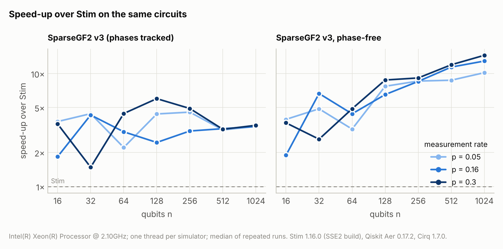
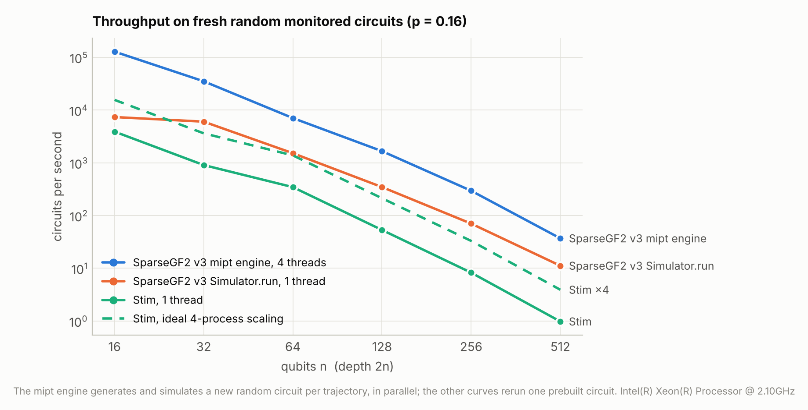

# SparseGF2 v3

**Fast stabilizer simulation for monitored random Clifford circuits, checked against Stim.**

<picture>
  <source media="(prefers-color-scheme: dark)" srcset="docs/figures/circuit-dark.png">
  
</picture>

SparseGF2 simulates Clifford circuits with mid-circuit measurements. It is built
for the physics of **monitored random circuits**: the measurement-induced and
purification transitions, the quantum error-correcting codes these circuits
generate as they run, and how well those codes survive erasures. It also runs
general circuits written in **Stim's circuit language** (surface-code memory
experiments included), and every operation is tested against Stim.

There are three ways in, from interactive to industrial:

| | what it is | use it for |
|---|---|---|
| [`Simulator`](#1-the-simulator-gate-by-gate) | a stabilizer state you act on gate by gate | exploring, small studies, exact entropies and code properties at any moment |
| [`Circuit` + `run` / `sample`](#2-circuits-in-stims-language) | Stim-language circuits, compiled to one call | measurement records, detectors, noise, many shots in parallel, observing the state at every `TICK` |
| [`mipt.MonitoredCircuit`](#3-ensembles-of-random-monitored-circuits) | random monitored circuits generated *and* simulated inside one compiled parallel kernel | the studies: millions of trajectories on collections of graphs, probes at the layers you choose, purification times with censoring, [erasure protection](#4-erasure-protection-of-the-generated-code) of the generated codes |

…and a [CLI and an MCP server](#for-ai-agents) so that AI agents can run all of it.

> **Status:** `3.0.0.dev9`, in development (import name `sparsegf2_v3`); it
> will take over the `sparsegf2` name as 3.0. The old package (v2, import
> `sparsegf2`) still lives at the repository root. See
> [Status and roadmap](#status-and-roadmap).

## Contents

* [Install and test](#install-and-test)
* [Quickstart](#quickstart): [Simulator](#1-the-simulator-gate-by-gate), [circuits](#2-circuits-in-stims-language), [ensembles](#3-ensembles-of-random-monitored-circuits), [erasure protection](#4-erasure-protection-of-the-generated-code)
* [What it shows: three standard experiments](#what-it-shows-three-standard-experiments)
* [Performance](#performance)
* [Phases: tracked or not](#phases-tracked-or-not)
* [For AI agents](#for-ai-agents)
* [How it works](#how-it-works)
* [Documentation map](#documentation-map)
* [Status and roadmap](#status-and-roadmap)

## Install and test

Python 3.11 or newer. From the repository root:

```sh
pip install -e "./v3[test]"        # add ,mcp for the MCP server:  "./v3[test,mcp]"
cd v3 && python -m pytest          # about 590 tests; Stim is required
```

The first call to each compiled kernel takes a few seconds while Numba compiles
it; the result is cached on disk, so later runs start immediately.

## Quickstart

### 1. The Simulator, gate by gate

```python
import sparsegf2_v3 as sg

sim = sg.Simulator(3, seed=1)       # |000>, signs tracked (phases=True is the default)
sim.h(0)
sim.cx(0, 1)
sim.cx(1, 2)                        # GHZ state
print(sim.stabilizers())            # [+XXX, +Z_Z, +_ZZ]  (Stim's canonical form)
print(sim.entropy([0]))             # 1 bit of entanglement between qubit 0 and the rest
outcome = sim.measure(0)            # 0 or 1
assert sim.peek_z(2) == (1 if outcome == 0 else -1)   # now determined: +1 / -1 like Stim
```

Every Stim gate is a method under its Stim name (`sim.sqrt_x_dag(q)`,
`sim.iswap(a, b)`, ...); `sim.measure_pauli("X0*Z3")`, `sim.reset_x(q)`,
`sim.peek_pauli(...)` and `sim.stabilizer_arrays()` cover the rest. Code and
erasure observables live in `sparsegf2_v3.observables`:

```python
from sparsegf2_v3 import observables as ob

# a 2-qubit code: system qubits 0, 1 each Bell-paired with a reference (2, 3), then scrambled
sim = sg.Simulator(4, seed=2)
for q in (0, 1):
    sim.h(q)
    sim.cx(q, q + 2)
sim.cx(0, 1)
sim.measure_pauli("Z0*Z1")          # measuring a system check removes one logical qubit
print(ob.code_dimension(sim, reference=[2, 3]))                    # 1 logical qubit left
print(ob.lost_logical_information(sim, erased=[0], reference=[2, 3]))  # bits lost if qubit 0 is erased
```

### 2. Circuits in Stim's language

```python
circuit = sg.Circuit("""
H 0
CX 0 1
M 0 1
DETECTOR rec[-1] rec[-2]
""")
result = sg.Simulator(2, seed=3).run(circuit)     # one compiled call
print(result.measurements, result.detectors)      # e.g. [0 0] [0]
shots = sg.sample(circuit, shots=10_000, seed=1)  # parallel over cores
print(shots.measurements.mean(axis=0))            # about [0.5 0.5]
```

`Circuit.from_stim(...)` / `circuit.to_stim()` convert both ways, so a
Stim-generated surface code runs as is, with noise, detectors and observables
(its detection-event statistics are tested against Stim's sampler). To watch
the state *as the circuit evolves*, pass `observe`: it is called at every `TICK`.

```python
circuit = sg.Circuit("H 0\nTICK\nCX 0 1\nTICK\nCX 1 2\nTICK")
result = sg.Simulator(3, seed=0).run(circuit, observe=lambda sim, tick: sim.entropy([0]))
print(result.observations)                        # [(0, 0), (1, 1), (2, 1)]
```

### 3. Ensembles of random monitored circuits

Describe the protocol once; the engine generates every trajectory's random
circuit and simulates it in compiled code, in parallel, recording *probes* at
*checkpoint* layers. Here: the measurement-induced transition in a brickwork
circuit on a ring, through the tripartite information of the four quarters.

```python
from sparsegf2_v3 import analysis, graphs, mipt

spec = mipt.MonitoredCircuit(
    num_system=64,
    edges=graphs.cycle(64),            # brickwork: the ring's edge colouring
    layers=256,
    measurement_rate=0.1,
    checkpoints=[256],
    probes=[mipt.half_cut_entropy(), mipt.tripartite_information()],
)
result = spec.run(trajectories=2000, seed=1)
mean, err = analysis.mean_and_error(-result.values["tripartite_information"][:, -1])
print(f"-I3 = {mean:.2f} ± {err:.2f}")
```

**Collections of graphs.** Pass a list of graphs as `edges` and each graph
is evolved with `circuits_per_graph` random circuits (default 1); a graph is
fixed for the whole circuit, never redrawn per layer. Trajectory `t` runs on
graph `t // circuits_per_graph`, and `spec.run(seed=...)` without a
trajectory count runs all `len(edges) * circuits_per_graph` of them. Here:
purification of a single reference qubit on 500 Watts–Strogatz graphs, four
circuits each, stopping each trajectory when the reference is pure:

```python
n = 32
spec = mipt.MonitoredCircuit(
    num_system=n,
    edges=[graphs.watts_strogatz(n, k=4, beta=0.1, seed=(1, g)) for g in range(500)],
    circuits_per_graph=4,
    layers=8 * n,
    measurement_rate=0.2,
    schedule="random_edges",           # n/2 random edges per layer, with replacement
    reference="single",
    reference_partner=n - 1,
    scramble_matchings=32,             # 32 layers of random all-to-all matchings first
    checkpoints="every_layer",
    stop_when_purified=True,
)
result = spec.run(seed=7)              # all spec.num_trajectories = 2000 trajectories
result.graph_index                     # the graph of each trajectory: 0, 0, 0, 0, 1, 1, ...
layers, surviving = result.survival()  # P(tau > t); result.purification_layer has tau (-1 = censored)
spec.circuit(trajectory=3, seed=7)     # the exact circuit trajectory 3 ran, as a Circuit
```

The same collection serves every measurement rate
(`dataclasses.replace(spec, measurement_rate=0.25)`), and with the same seed
the gates and random numbers are shared across rates: the qubits measured at
a lower rate are a subset of those measured at a higher one.
`spec.with_edges(...)` puts the protocol on other graphs.

**Probes on their own schedules.** Every probe takes `checkpoints=` (the same
forms as the spec's: `"final"`, `"every_layer"`, a stride or a list of
layers), so expensive probes run at a few depths while cheap ones run at every
layer; purification is tested at the spec's checkpoints. Here in the
purification picture, where every system qubit starts Bell-paired with its own
reference, so the system starts maximally mixed and the reference holds the
logical information:

```python
n = 32
spec = mipt.MonitoredCircuit(
    num_system=n, edges=graphs.cycle(n), layers=64, measurement_rate=0.3,
    reference="purification", checkpoints="every_layer", stop_when_purified=True,
    probes=[mipt.code_dimension(),                                  # every layer
            mipt.contiguous_distance(checkpoints=16),              # layers 0, 16, ..., 64
            mipt.erasure_first_failure(samples=20, checkpoints=[32, 64])],
)
result = spec.run(100, seed=3)
result.layers("contiguous_distance")           # [ 0 16 32 48 64]
result.values["erasure_first_failure"].shape   # (100, 2, 20): trajectories, evaluations, samples
rate = result.values["code_dimension"].mean(axis=0) / n   # code rate k/n at every layer
```

After `stop_when_purified` ends a trajectory, the code probes record their
exact values for a pure reference: code dimension 0, lost information 0,
first-failure size n + 1, no uncorrectable regions. So code-rate averages need
no special handling. Entanglement probes and `contiguous_distance` record NaN
there (`result.mean(name)` skips NaN).

Probes: entanglement (`entropy`, `half_cut_entropy`, `mutual_information`,
`tripartite_information`, and the vector `entropy_profile`, one value per
cut) and the code (`code_dimension`, `contiguous_distance`,
`lost_information` of a fixed region, the vector `erasure_lost_profile` of
mean lost information per erasure size, and `erasure_first_failure`,
`uncorrectable_region_counts` and `code_snapshot`, described next).
`result.values[name]` has shape `(trajectories, evaluations)`, or
`(trajectories, evaluations, length)` for a vector probe, with the layers in
`result.layers(name)`. Trajectory `t` depends only on `(spec, seed, t)`,
never on the thread count, so big runs split into chunks
(`spec.run(count, seed=..., first_trajectory=...)`) and merge with
`EnsembleResult.concatenate`; `result.save(path)` /
`EnsembleResult.load(path)` keep everything, spec and saved codes included.
[`examples/purification_time.py`](examples/purification_time.py) is a full
purification-time study on a graph collection.

### 4. Erasure protection of the generated code

Run the dynamics in the purification picture; the system then holds a code C
with stabilizer group S on n qubits and k logical qubits (the code rate is
k/n). Now erase every qubit independently with probability e. Erasing a set A
destroys l(A) bits of logical information, and the erasure is correctable
exactly when l(A) = 0:

```text
l(A)   = I(A:R) = rank N(S)|_A − rank S|_A           bits lost by erasing A
P_C(m) = probability that a uniformly random m-qubit erasure is uncorrectable
Φ_C(e) = Σ_m C(n,m) e^m (1 − e)^(n − m) P_C(m)       failure probability under erasure rate e
e_δ    = sup{ e : Φ(e) ≤ δ }                          Φ = mean of Φ_C over the ensemble
```

Three probes measure this inside the engine:

* `erasure_first_failure(samples=M)`: for each of M uniformly random orderings
  of the qubits, the first-failure size D_j, the smallest m such that erasing
  the first m qubits is uncorrectable (n + 1 when k = 0). One ordering
  answers every m at once: P_C(m) is estimated by the fraction of D_j ≤ m, and
  Φ_C(e) by the mean over j of Pr[Bin(n, e) ≥ D_j].
* `uncorrectable_region_counts(max_size=w)`: the number of uncorrectable
  m-qubit erasures for m = 1..w, by exhaustion, so P_C(m) = count / C(n, m)
  exactly; all counts are 0 exactly when the distance exceeds w.
* `code_snapshot()`: the code's stabilizer generators, saved with the result;
  `result.code(t, c)` returns trajectory row `t`'s code at evaluation `c` as a
  `StabilizerCode`, to analyse again later with more orderings or a larger w.

`sparsegf2_v3.analysis` turns these into the physics:
`erasure_failure_probability` gives Φ_C(e), exact for m ≤ w and sampled above
when given the counts (the hybrid estimator Σ_{m≤w} C(n,m) e^m (1 − e)^(n−m) P_C(m)
+ mean_j Pr[Bin(n, e) ≥ max(D_j, w + 1)]); `erasure_tolerance` gives e_δ for
an ensemble; `failure_by_size` and `exact_failure_by_size` give P_C(m).

```python
from sparsegf2_v3 import StabilizerCode

n = 32
spec = mipt.MonitoredCircuit(
    num_system=n,
    edges=[graphs.watts_strogatz(n, 4, 0.1, seed=(0, g)) for g in range(8)],
    circuits_per_graph=4,                                   # 8 graphs x 4 circuits = 32 trajectories
    layers=64, measurement_rate=0.05, schedule="random_edges",
    reference="purification", checkpoints=16,
    probes=[mipt.code_dimension(),
            mipt.erasure_first_failure(samples=100),
            mipt.uncorrectable_region_counts(2),
            mipt.code_snapshot(checkpoints="final")],       # codes are big: save them once
)
res = spec.run(seed=1)
k = res.values["code_dimension"]                            # (32, 5): layers 0, 16, ..., 64
first = res.values["erasure_first_failure"]                 # (32, 5, 100)
counts = res.values["uncorrectable_region_counts[2]"]       # (32, 5, 2)

e = [0.05, 0.1]
phi = analysis.erasure_failure_probability(first[:, -1], n, e, exact_counts=counts[:, -1]).mean(axis=0)
code = k[:, -1] > 0                                         # circuits that kept a code (k = 0 gives Phi = 0)
e10 = analysis.erasure_tolerance(first[code, -1], n, 0.1, exact_counts=counts[code, -1])
p_m = analysis.failure_by_size(first[code, -1], n).mean(axis=0)   # P_C(m), m = 0..n

c0 = res.code(0, 0)                                         # trajectory 0's final code
print(c0, c0.uncorrectable_counts(3))                       # StabilizerCode(n=32, k=..., ...)
more = c0.first_failure_sizes(1000, seed=0)                 # 1000 more orderings, offline

toy = StabilizerCode(["XXXX", "ZZZZ"])                      # a code from Pauli strings: [[4, 2, 2]]
print(toy.lost_information([0]), toy.lost_information([0, 1]))   # 0 2
```

Costs per evaluation at n = 256, one thread, on random-circuit codes
(trajectories run in parallel over all cores):

| probe | cost |
|---|---|
| `erasure_first_failure`, M = 100 | 3–7 ms |
| `uncorrectable_region_counts`, w = 2 | about 1 ms |
| `uncorrectable_region_counts`, w = 3 | 40–50 ms |
| `uncorrectable_region_counts`, w = 4 | about 7 s (C(256, 4) = 1.7·10⁸ subsets: only at a few depths) |
| `code_snapshot` | under 1 ms |

[`examples/code_and_erasure.py`](examples/code_and_erasure.py) runs the whole
workflow versus depth: code rate, the fraction of circuits that keep a code,
Φ(e) at several erasure rates, e_δ conditioned on k > 0, and a saved code
analysed again with ten times more orderings.

## What it shows: three standard experiments

All three figures come from [`benchmarks/physics_data.py`](benchmarks/physics_data.py)
(a few minutes on a laptop).

<picture>
  <source media="(prefers-color-scheme: dark)" srcset="docs/figures/transition-dark.png">
  
</picture>

**The measurement-induced transition.** Below the critical measurement rate the
steady state has volume-law entanglement and −I₃ grows with system size; above
it, entanglement obeys an area law and −I₃ vanishes. The curves for different
`n` cross at p_c ≈ 0.16, the known value for this circuit family.

<picture>
  <source media="(prefers-color-scheme: dark)" srcset="docs/figures/purification-dark.png">
  
</picture>

**Purification.** A reference qubit entangled with the system stays mixed for
a time that grows exponentially with `n` in the mixed phase (left: the larger
systems never purify within 4000 layers) and only logarithmically in the pure
phase (right). This is the same transition seen as a dynamical protection of
quantum information.

<picture>
  <source media="(prefers-color-scheme: dark)" srcset="docs/figures/erasure-dark.png">
  
</picture>

**Erasure protection.** Starting maximally mixed, the circuit's measurements
purify the system; what is left is a code with `k` logical qubits (left). At
any moment the code can be tested against erasures: erasing a set E of qubits
is correctable exactly when E holds no logical information, I(R:E) = 0 (right:
the probability for a random E of each size, from first-failure sizes; see
[section 4](#4-erasure-protection-of-the-generated-code)).

## Performance

<picture>
  <source media="(prefers-color-scheme: dark)" srcset="docs/figures/runtime-dark.png">
  
</picture>

The workload is the one this simulator exists for: `n` qubits on a ring, depth
`2n`, uniformly random two-qubit Cliffords in a brickwork, every qubit measured
in Z with probability `p` after each layer. Every simulator runs the same
circuits on one core, and the final states are cross-checked. On this
machine (4-core Xeon, 2.1 GHz):

* **Phase-free mode** (entanglement, codes, purification): **3–15× faster than
  Stim for n ≥ 64**, and the margin grows with `n`: about 9× at n = 256 and
  9–15× at n = 512–1024 (2–7× at n = 16–32).
* **With signs tracked** (the default; outcomes, detectors): about **3× faster
  than Stim** (1.5–6× across all points).
* In either mode, **300–1800× faster than Qiskit Aer** (stabilizer method)
  and **1300–9000× faster than Cirq**.

<picture>
  <source media="(prefers-color-scheme: dark)" srcset="docs/figures/speedup-dark.png">
  
</picture>

For small systems a single `Simulator.run` call is dominated by Python
overhead (the 1.5–2× points at n = 16–32). Many small circuits are what the
ensemble engine is for: it generates and simulates a fresh random circuit per
trajectory inside one compiled, parallel kernel.

<picture>
  <source media="(prefers-color-scheme: dark)" srcset="docs/figures/throughput-dark.png">
  
</picture>

At p = 0.16 that is about **128,000 circuits per second at n = 16, 7,000 at
n = 64 and 1,700 at n = 128** on 4 cores. At n = 128, Stim manages 53 per
second on one core, or about 210 if run as four perfectly parallel processes.

<details>
<summary>All the numbers</summary>

**Milliseconds per circuit, p = 0.05** (depth 2n; speed-up over Stim in brackets)

| n | SparseGF2 v3 | SparseGF2 v3, phase-free | Stim | Qiskit Aer (stabilizer) | Cirq (Clifford) |
|---:|---:|---:|---:|---:|---:|
| 16 | 0.045 (3.8×) | 0.043 (3.9×) | 0.169 | 40.2 | 180 |
| 32 | 0.134 (4.4×) | 0.121 (4.9×) | 0.590 | 175 | 702 |
| 64 | 0.828 (2.2×) | 0.569 (3.2×) | 1.83 | 807 | 4,683 |
| 128 | 2.80 (4.4×) | 1.59 (7.7×) | 12.3 | 2,919 | – |
| 256 | 14.9 (4.6×) | 7.89 (8.6×) | 67.8 | 12,632 | – |
| 512 | 142 (3.2×) | 51.4 (8.7×) | 449 | – | – |
| 1024 | 1,286 (3.4×) | 430 (10.2×) | 4,379 | – | – |

**Milliseconds per circuit, p = 0.16** (depth 2n; speed-up over Stim in brackets)

| n | SparseGF2 v3 | SparseGF2 v3, phase-free | Stim | Qiskit Aer (stabilizer) | Cirq (Clifford) |
|---:|---:|---:|---:|---:|---:|
| 16 | 0.140 (1.8×) | 0.136 (1.9×) | 0.257 | 65.7 | 182 |
| 32 | 0.258 (4.3×) | 0.166 (6.7×) | 1.11 | 196 | 816 |
| 64 | 0.951 (3.1×) | 0.660 (4.4×) | 2.90 | 789 | 5,960 |
| 128 | 7.69 (2.5×) | 2.90 (6.5×) | 18.9 | 3,243 | – |
| 256 | 39.3 (3.1×) | 14.3 (8.5×) | 122 | 12,667 | – |
| 512 | 316 (3.3×) | 89.9 (11.4×) | 1,026 | – | – |
| 1024 | 3,025 (3.4×) | 796 (12.9×) | 10,276 | – | – |

**Milliseconds per circuit, p = 0.3** (depth 2n; speed-up over Stim in brackets)

| n | SparseGF2 v3 | SparseGF2 v3, phase-free | Stim | Qiskit Aer (stabilizer) | Cirq (Clifford) |
|---:|---:|---:|---:|---:|---:|
| 16 | 0.087 (3.6×) | 0.085 (3.7×) | 0.312 | 43.6 | 178 |
| 32 | 0.590 (1.5×) | 0.333 (2.6×) | 0.873 | 187 | 1,141 |
| 64 | 1.28 (4.4×) | 1.16 (4.9×) | 5.68 | 665 | 7,349 |
| 128 | 6.59 (6.0×) | 4.50 (8.8×) | 39.5 | 4,109 | – |
| 256 | 39.0 (4.9×) | 20.9 (9.1×) | 192 | 13,027 | – |
| 512 | 521 (3.2×) | 140 (12.0×) | 1,672 | – | – |
| 1024 | 4,598 (3.5×) | 1,103 (14.5×) | 16,010 | – | – |

**Ensemble engine throughput** (fresh random circuits, depth 2n, 4 threads), circuits per second

| p | n = 16 | n = 32 | n = 64 | n = 128 | n = 256 | n = 512 |
|---:|---:|---:|---:|---:|---:|---:|
| 0.05 | 180,855 | 48,985 | 12,860 | 2,803 | 538 | 78 |
| 0.16 | 127,998 | 35,072 | 7,035 | 1,658 | 294 | 37 |
| 0.3 | 96,749 | 27,296 | 6,390 | 1,312 | 225 | 38 |

</details>

**How the comparison is kept fair** (details in
[`benchmarks/README.md`](benchmarks/README.md)):

* Identical circuits for every simulator. SparseGF2 applies each random
  Clifford as one fused gate (`CLIFFORD_2Q`), which is part of what it offers.
  Stim gets each Clifford in its tightest form, at most five of its native
  gates with each layer batched into a few instructions; every decomposition
  is checked against the Clifford's tableau.
* Each simulator's fastest documented path. Stim runs a prebuilt circuit with
  `TableauSimulator.do_circuit`. Stim 1.16 from PyPI ships an SSE2 build; a
  `-march=native` source build was slower on this machine, so the PyPI build
  is used.
* One thread each, median of repeated runs after a warm-up; SparseGF2's
  one-off compilation is excluded, Qiskit Aer's per-run circuit conversion is
  included (it is part of its API).

**Where other tools are better.** For sampling millions of shots of a
quantum error-correction circuit, use Stim's detector sampler: Pauli-frame
simulation is a different algorithm and is far faster than any tableau
simulator for that job. And deep in the area-law phase at very large n, every
random measurement scans all n columns for the pivot's support, which a
row-major layout avoids; the planned row cache
([DESIGN.md §5.3](docs/DESIGN.md#53-operations-and-their-cost)) targets
exactly that case.

## Phases: tracked or not

`Simulator(n, phases=True)` (the default) tracks stabilizer signs and
destabilizers, so measurement outcomes, detectors and observables are exact:
replaying Stim's measurement record reproduces every outcome, and
deterministic detectors and observables give exactly Stim's detection events. `phases=False` stores only the stabilizers' X/Z bits:
entanglement, code dimension, distances and erasure quantities are all exactly
the same (they never depend on signs), it is faster, and asking for an outcome
says why there is none (`measure()` returns `None`; `result.measurements`
raises `PhaseFreeError`; `result.random` still tells which outcomes were
random). The ensemble engine always runs phase-free.

## For AI agents

SparseGF2 is designed to be driven by language-model agents as easily as by
people:

* **MCP server**: `pip install -e "./v3[mcp]"`, then `claude mcp add sparsegf2 -- sparsegf2-mcp`
  (the repository's `.mcp.json` already registers it for Claude Code). Tools
  cover discovery, circuit checking, running circuits with observables,
  ensembles (graph collections and the erasure probes included), runtime and
  memory estimates, and background jobs for long ensembles with resumable
  chunk files.
* **CLI**: `sparsegf2 capabilities | inspect | run | ensemble | results`, with
  `--json` on every command.
* **Python**: `sparsegf2_v3.api`, the JSON-in/JSON-out layer both of those use.

Start with [`AGENTS.md`](AGENTS.md) (also [`llms.txt`](llms.txt)); the
reference is [`docs/LLM_INTERFACE.md`](docs/LLM_INTERFACE.md).

## How it works

The state is an Aaronson–Gottesman stabilizer tableau stored **column-major**:
for every qubit, two bitsets over the stabilizer generators (its X and Z
components), packed 64 generators per machine word.

* A two-qubit gate rewrites four bitsets with word-wide XORs (each new column
  is the XOR of at most four old ones), so it costs n/64 word operations no
  matter how entangled the state is.
* A measurement finds the anticommuting generators with one word-wide test,
  then multiplies the pivot into them by XORing one bitset into each column in
  the pivot's support.
* The entropy of a region A is the GF(2) rank of A's 2|A| column bitsets, read
  directly with no transposition; an entanglement profile or an erasure
  profile is one incremental pass over an ordering.
* In the ensemble engine the pivot prefers generators that do not touch the
  reference, which keeps the reference-touching rows a basis: the code
  dimension is then a popcount and the information an erasure leaks is a rank
  difference over the erased qubits only.
* For the erasure probes the system's columns are written in a row basis
  adapted to the code (the first s rows span S, all n + k rows span N(S)), so
  l(A) is the difference of two ranks over A's columns. Exhaustive counting
  skips the N(S) rank while the S-rank is full, and settles the last qubit of
  every correctable prefix at once: it enumerates the prefix's span and looks
  up each qubit's X, Z and Y columns in hash tables.

[`docs/DESIGN.md`](docs/DESIGN.md) explains the layout (chosen by benchmark),
the sign tracking, the randomness contract and the validation strategy.

## Documentation map

| document | what it covers |
|---|---|
| [`docs/DESIGN.md`](docs/DESIGN.md) | architecture, kernel, decisions, roadmap |
| [`docs/LITERATURE.md`](docs/LITERATURE.md) | the literature review behind the feature set (protocols, observables, codes, erasure, graphs) |
| [`docs/AUDIT.md`](docs/AUDIT.md) | the audit of the old v2 package that shaped this design |
| [`AGENTS.md`](AGENTS.md), [`docs/LLM_INTERFACE.md`](docs/LLM_INTERFACE.md) | running SparseGF2 from AI agents (MCP, CLI, JSON API) |
| [`examples/`](examples/) | complete study scripts: purification times on a graph collection, transition scans, and [`code_and_erasure.py`](examples/code_and_erasure.py), the erasure workflow |
| [`benchmarks/`](benchmarks/) | the speed comparison and the figure data |
| [`CHANGELOG.md`](CHANGELOG.md) | what changed in each development version |

The module docstrings of `sparsegf2_v3.mipt` (protocol and probes),
`sparsegf2_v3.codes` (`StabilizerCode`) and `sparsegf2_v3.analysis`
(survival and erasure estimators) are the API reference.

## Status and roadmap

Done: the kernel and `Simulator` (both modes, lock-step tested against Stim
with exact signs and outcomes), Stim-language circuits with noise, detectors
and parallel sampling, the observables (state-vector checked), the ensemble
engine with graph collections (several circuits per graph), pictures,
scrambles and probes on their own schedules, survival analysis, erasure
protection of the generated codes (first-failure sizes, exhaustive counts,
code snapshots, `StabilizerCode`, and the Φ(e) and e_δ estimators), the agent
interface, and the benchmarks.

Next (see [DESIGN.md §14](docs/DESIGN.md#14-roadmap)): a row cache for large
systems in the area-law phase, erasure and noise channels during the
circuit, expurgation, more measurement schedules, and annealed (per-layer)
graph disorder.
