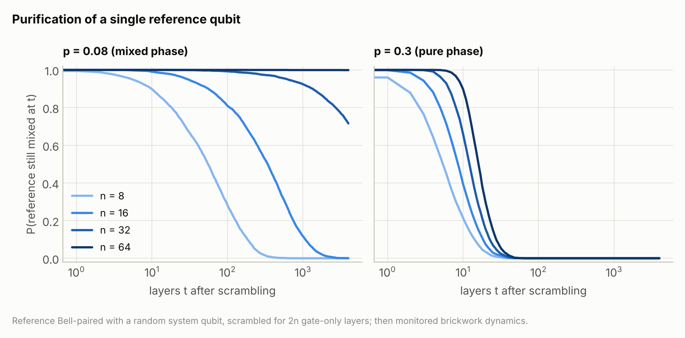
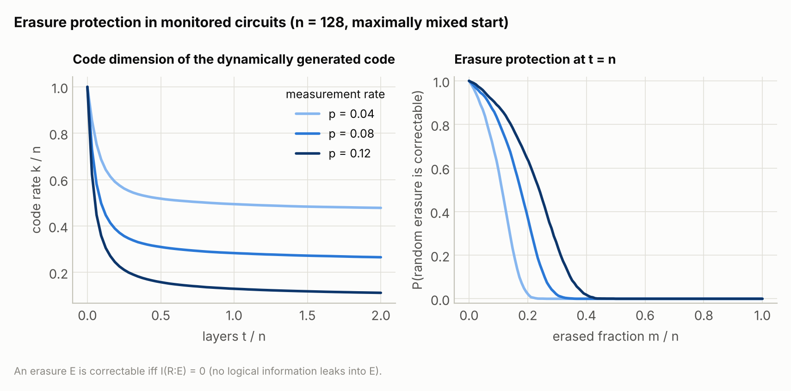

# SparseGF2 v3

**Fast stabilizer simulation for monitored random Clifford circuits, checked against Stim.**

<picture>
  <source media="(prefers-color-scheme: dark)" srcset="docs/figures/circuit-dark.png">
  
</picture>

SparseGF2 simulates Clifford circuits with mid-circuit measurements. It is built
for the physics of **monitored random circuits**: the measurement-induced and
purification transitions, the quantum error-correcting codes these circuits
generate as they run, and how well those codes survive erasures. It also runs
general circuits written in **Stim's circuit language** (surface-code memory
experiments included), and every operation is tested against Stim.

There are three ways in, from interactive to industrial:

| | what it is | use it for |
|---|---|---|
| [`Simulator`](#1-the-simulator-gate-by-gate) | a stabilizer state you act on gate by gate | exploring, small studies, exact entropies and code properties at any moment |
| [`Circuit` + `run` / `sample`](#2-circuits-in-stims-language) | Stim-language circuits, compiled to one call | measurement records, detectors, noise, many shots in parallel, observing the state at every `TICK` |
| [`mipt.MonitoredCircuit`](#3-ensembles-of-random-monitored-circuits) | random monitored circuits generated *and* simulated inside one compiled parallel kernel | the studies: millions of trajectories, probes at every layer, purification times with censoring |

…and a [CLI and an MCP server](#for-ai-agents) so that AI agents can run all of it.

> **Status:** `3.0.0.dev7`, in development beside the v2 package (import name
> `sparsegf2_v3`). It will take over the `sparsegf2` name as 3.0. See
> [Status and roadmap](#status-and-roadmap).

## Contents

* [Install and test](#install-and-test)
* [Quickstart](#quickstart): [Simulator](#1-the-simulator-gate-by-gate), [circuits](#2-circuits-in-stims-language), [ensembles](#3-ensembles-of-random-monitored-circuits)
* [What it shows: three standard experiments](#what-it-shows-three-standard-experiments)
* [Performance](#performance)
* [Phases: tracked or not](#phases-tracked-or-not)
* [For AI agents](#for-ai-agents)
* [How it works](#how-it-works)
* [Documentation map](#documentation-map)
* [Status and roadmap](#status-and-roadmap)

## Install and test

Python 3.11 or newer. From the repository root:

```sh
pip install -e "./v3[test]"        # add ,mcp for the MCP server:  "./v3[test,mcp]"
cd v3 && python -m pytest          # ~500 tests, about a minute; Stim is required
```

The first call to each compiled kernel takes a few seconds while Numba compiles
it; the result is cached on disk, so later runs start immediately.

## Quickstart

### 1. The Simulator, gate by gate

```python
import sparsegf2_v3 as sg

sim = sg.Simulator(3, seed=1)       # |000>, signs tracked (phases=True is the default)
sim.h(0)
sim.cx(0, 1)
sim.cx(1, 2)                        # GHZ state
print(sim.stabilizers())            # [+XXX, +Z_Z, +_ZZ]  (Stim's canonical form)
print(sim.entropy([0]))             # 1 bit of entanglement between qubit 0 and the rest
outcome = sim.measure(0)            # 0 or 1
assert sim.peek_z(2) == (1 if outcome == 0 else -1)   # now determined: +1 / -1 like Stim
```

Every Stim gate is a method under its Stim name (`sim.sqrt_x_dag(q)`,
`sim.iswap(a, b)`, ...); `sim.measure_pauli("X0*Z3")`, `sim.reset_x(q)`,
`sim.peek_pauli(...)` and `sim.stabilizer_arrays()` cover the rest. Code and
erasure observables live in `sparsegf2_v3.observables`:

```python
from sparsegf2_v3 import observables as ob

# a 2-qubit code: system qubits 0, 1 each Bell-paired with a reference (2, 3), then scrambled
sim = sg.Simulator(4, seed=2)
for q in (0, 1):
    sim.h(q)
    sim.cx(q, q + 2)
sim.cx(0, 1)
sim.measure_pauli("Z0*Z1")          # measuring a system check removes one logical qubit
print(ob.code_dimension(sim, reference=[2, 3]))                    # 1 logical qubit left
print(ob.lost_logical_information(sim, erased=[0], reference=[2, 3]))  # bits lost if qubit 0 is erased
```

### 2. Circuits in Stim's language

```python
circuit = sg.Circuit("""
H 0
CX 0 1
M 0 1
DETECTOR rec[-1] rec[-2]
""")
result = sg.Simulator(2, seed=3).run(circuit)     # one compiled call
print(result.measurements, result.detectors)      # e.g. [0 0] [0]
shots = sg.sample(circuit, shots=10_000, seed=1)  # parallel over cores
print(shots.measurements.mean(axis=0))            # about [0.5 0.5]
```

`Circuit.from_stim(...)` / `circuit.to_stim()` convert both ways, so a
Stim-generated surface code runs as is, with noise, detectors and observables
(its detection-event statistics are tested against Stim's sampler). To watch
the state *as the circuit evolves*, pass `observe`: it is called at every `TICK`.

```python
circuit = sg.Circuit("H 0\nTICK\nCX 0 1\nTICK\nCX 1 2\nTICK")
result = sg.Simulator(3, seed=0).run(circuit, observe=lambda sim, tick: sim.entropy([0]))
print(result.observations)                        # [(0, 0), (1, 1), (2, 1)]
```

### 3. Ensembles of random monitored circuits

Describe the protocol once; the engine generates every trajectory's random
circuit and simulates it in compiled code, in parallel, recording *probes* at
*checkpoint* layers. Here: the measurement-induced transition in a brickwork
circuit on a ring, through the tripartite information of the four quarters.

```python
from sparsegf2_v3 import analysis, graphs, mipt

spec = mipt.MonitoredCircuit(
    num_system=64,
    edges=graphs.cycle(64),            # brickwork: the ring's edge colouring
    layers=256,
    measurement_rate=0.1,
    checkpoints=[256],
    probes=[mipt.half_cut_entropy(), mipt.tripartite_information()],
)
result = spec.run(trajectories=2000, seed=1)
mean, err = analysis.mean_and_error(-result.values["tripartite_information"][:, -1])
print(f"-I3 = {mean:.2f} ± {err:.2f}")
```

Purification of a single reference qubit on small-world graphs, with one
Watts–Strogatz realization per trajectory, stopping each trajectory when the
reference is pure:

```python
n, T = 32, 2000
spec = mipt.MonitoredCircuit(
    num_system=n,
    edges=[graphs.watts_strogatz(n, k=4, beta=0.1, seed=(1, i)) for i in range(T)],
    layers=8 * n,
    measurement_rate=0.2,
    schedule="random_edges",           # n/2 random edges per layer, with replacement
    reference="single",
    reference_partner=n - 1,
    scramble_matchings=32,             # 32 layers of random all-to-all matchings first
    checkpoints="every_layer",
    stop_when_purified=True,
)
result = spec.run(trajectories=T, seed=7)
layers, surviving = result.survival()  # P(tau > t); result.purification_layer has tau (-1 = censored)
spec.circuit(trajectory=3, seed=7)     # the exact circuit trajectory 3 ran, as a Circuit
```

Codes and erasures in the purification picture (every system qubit starts
Bell-paired with its own reference, so the system starts maximally mixed and
the reference holds the logical information):

```python
spec = mipt.MonitoredCircuit(
    num_system=64, edges=graphs.cycle(64), layers=64, measurement_rate=0.08,
    reference="purification", checkpoints=[64],
    probes=[mipt.code_dimension(), mipt.contiguous_distance(),
            mipt.erasure_correctable_profile(samples=8)],
)
result = spec.run(500, seed=3)
k = result.mean("code_dimension")[-1]                      # logical qubits left
profile = result.mean("erasure_correctable_profile")[-1]   # P(erasing m random qubits is correctable)
failure = analysis.bernoulli_erasure_curve(1 - profile, [0.01, 0.05, 0.1])  # i.i.d. erasure
```

Probes: `code_dimension`, `entropy`, `half_cut_entropy`, `mutual_information`,
`tripartite_information`, `contiguous_distance`, `lost_information`,
`erasure_lost_information`, `erasure_correctable_fraction`, and the vector
probes `entropy_profile`, `erasure_lost_profile`, `erasure_correctable_profile`
(one value per region size). Trajectory `t` depends only on `(spec, seed, t)`,
never on the thread count, so big runs split into chunks
(`first_trajectory=`) and merge with `EnsembleResult.concatenate`;
`result.save(path)` / `EnsembleResult.load(path)` keep everything, spec
included. [`examples/purification_time.py`](examples/purification_time.py)
is the full PRL production protocol.

## What it shows: three standard experiments

All three figures come from [`benchmarks/physics_data.py`](benchmarks/physics_data.py)
(a few minutes on a laptop).

<picture>
  <source media="(prefers-color-scheme: dark)" srcset="docs/figures/transition-dark.png">
  
</picture>

**The measurement-induced transition.** Below the critical measurement rate the
steady state has volume-law entanglement and −I₃ grows with system size; above
it, entanglement obeys an area law and −I₃ vanishes. The curves for different
`n` cross at p_c ≈ 0.16, the known value for this circuit family.

<picture>
  <source media="(prefers-color-scheme: dark)" srcset="docs/figures/purification-dark.png">
  
</picture>

**Purification.** A reference qubit entangled with the system stays mixed for
a time that grows exponentially with `n` in the mixed phase (left: the larger
systems never purify within 4000 layers) and only logarithmically in the pure
phase (right). This is the same transition seen as a dynamical protection of
quantum information.

<picture>
  <source media="(prefers-color-scheme: dark)" srcset="docs/figures/erasure-dark.png">
  
</picture>

**Erasure protection.** Starting maximally mixed, the circuit's measurements
purify the system; what is left is a code with `k` logical qubits (left). At
any moment the code can be tested against erasures: erasing a set E of qubits
is correctable exactly when E holds no logical information, I(R:E) = 0 (right:
the probability for a random E of each size).

## Performance

How fast SparseGF2 v3 is, and how that was measured, comes from the scripts in
[`benchmarks/`](benchmarks/README.md): the same monitored circuits are run by
SparseGF2 v3 (both modes), Stim, Qiskit Aer, Cirq and SparseGF2 v2, one thread
each, with the final states cross-checked; the ensemble engine's throughput
and the production-protocol comparison with v2 are measured separately. The
results and figures are being regenerated on an idle machine and will appear
here.

## Phases: tracked or not

`Simulator(n, phases=True)` (the default) tracks stabilizer signs and
destabilizers, so measurement outcomes, detectors and observables are exact
and identical to Stim's. `phases=False` stores only the stabilizers' X/Z bits:
entanglement, code dimension, distances and erasure quantities are all exactly
the same (they never depend on signs), it is faster, and asking for an outcome
says why there is none (`measure()` returns `None`; `result.measurements`
raises `PhaseFreeError`; `result.random` still tells which outcomes were
random). The ensemble engine always runs phase-free.

## For AI agents

SparseGF2 is designed to be driven by language-model agents as easily as by
people:

* **MCP server**: `pip install -e "./v3[mcp]"`, then `claude mcp add sparsegf2 -- sparsegf2-mcp`
  (the repository's `.mcp.json` already registers it for Claude Code). Tools
  cover discovery, circuit checking, running circuits with observables,
  ensembles, runtime estimates, and background jobs for long ensembles with
  resumable chunk files.
* **CLI**: `sparsegf2 capabilities | inspect | run | ensemble | results`, with
  `--json` on every command.
* **Python**: `sparsegf2_v3.api`, the JSON-in/JSON-out layer both of those use.

Start with [`AGENTS.md`](AGENTS.md) (also [`llms.txt`](llms.txt)); the
reference is [`docs/LLM_INTERFACE.md`](docs/LLM_INTERFACE.md).

## How it works

The state is an Aaronson–Gottesman stabilizer tableau stored **column-major**:
for every qubit, two bitsets over the stabilizer generators (its X and Z
components), packed 64 generators per machine word.

* A two-qubit gate rewrites four bitsets with word-wide XORs (each new column
  is the XOR of at most four old ones), so it costs n/64 word operations no
  matter how entangled the state is.
* A measurement finds the anticommuting generators with one word-wide test,
  then multiplies the pivot into them by XORing one bitset into each column in
  the pivot's support.
* The entropy of a region A is the GF(2) rank of A's 2|A| column bitsets, read
  directly with no transposition; an entanglement profile or an erasure
  profile is one incremental pass over an ordering.
* In the ensemble engine the pivot prefers generators that do not touch the
  reference, which keeps the reference-touching rows a basis: the code
  dimension is then a popcount and the information an erasure leaks is a rank
  difference over the erased qubits only.

[`docs/DESIGN.md`](docs/DESIGN.md) explains the layout (chosen by benchmark),
the sign tracking, the randomness contract and the validation strategy.

## Documentation map

| document | what it covers |
|---|---|
| [`docs/DESIGN.md`](docs/DESIGN.md) | architecture, kernel, decisions, roadmap |
| [`docs/LITERATURE.md`](docs/LITERATURE.md) | the literature review behind the feature set (protocols, observables, codes, erasure, graphs) |
| [`docs/AUDIT.md`](docs/AUDIT.md) | the audit of v2 this version responds to |
| [`AGENTS.md`](AGENTS.md), [`docs/LLM_INTERFACE.md`](docs/LLM_INTERFACE.md) | running SparseGF2 from AI agents (MCP, CLI, JSON API) |
| [`examples/`](examples/) | complete study scripts |
| [`benchmarks/`](benchmarks/) | the speed comparison, the v2 cross-check and the figure data |
| [`CHANGELOG.md`](CHANGELOG.md) | what changed in each development version |

## Status and roadmap

Done: the kernel and `Simulator` (both modes, lock-step tested against Stim
with exact signs and outcomes), Stim-language circuits with noise, detectors
and parallel sampling, the observables (state-vector checked), the ensemble
engine with graph banks, pictures, scrambles and probes, survival analysis,
the agent interface, and the benchmarks.

Next (see [DESIGN.md §14](docs/DESIGN.md#14-roadmap)): a row cache for large
systems in the area-law phase, erasure and noise channels inside the engine,
expurgation, more measurement schedules, and annealed (per-layer) graph
disorder.
